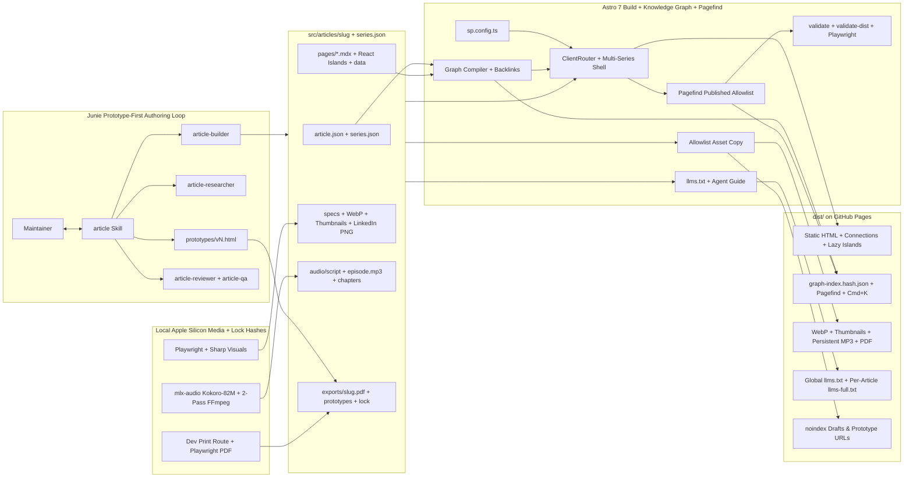

# Requirements

### Overview & Goals
Rebuild `sujeet.pro` into a fast, de-cluttered, keyboard-first static site on GitHub Pages for **Principal Engineer interactive technical deep-dive articles** authored, prototyped, researched, narrated, tested, and revised with **Junie**. Every article opens with a crisp **Quick Read**, expands into an interactive **Full Production Reference**, connects cleanly inside a **many-to-many Knowledge Graph** (multi-series memberships, shared deep-dives, building blocks, backlinks, and context-aware breadcrumbs), offers a **single-host synced podcast audio companion** with transcript, provides a **branded `sujeet.pro` PDF edition**, and exposes structured `llms.txt` endpoints with a 1-click AI prompt for readers' own LLMs. Every technical design reflects **today's AI-era engineering economics** and **real-world organizational bottlenecks** (resource alignment, timelines, adoption, and total cost).

**Editorial thesis — Evolution-First, Right-Sized Design**: Interview answers jump straight to the planet-scale design; real companies rarely need it. Every Design X, Building Block, and Business Story article **evolves the system incrementally**: it starts with the simplest thing that works, and each level is unlocked by an explicit **trigger** (the business grows, scale crosses a threshold, an incident exposes a weakness, a stakeholder asks for a feature, or cost or the org changes). At each level the article shows only what is required, what is **deliberately deferred**, and when the design must be **replaced** instead of extended. The articles are meant to show judgement, not maximal architecture.

**Visual-first explanation**: Content is written as short **key-point bullets paired with visuals**. A static image shows the one case being discussed and can be switched to an **interactive view** that covers the other cases (other levels, failures, configurations). Where it helps, a stage carries several figures. Long prose paragraphs are the exception.

### Scope

#### In Scope
- **Uniform layout width**: Every surface — top bar, context breadcrumb bar, article header, Quick Read, stage blocks, labs, Connections panel, footer, and the inner row of the audio bar — shares one container (`--sp-container: 1140px`, the current header width) so the left and right edges line up exactly. Text inside the container is left-aligned and capped at a readable measure (`--sp-measure`); it is never re-centred in a narrower column.
- **Evolution-first article structure (Design X, Building Block, Business Story)**: Articles are built from ordered **Stage blocks** (`L0 … Ln`). Each block holds: trigger scenario → requirement delta → 2–5 key-point bullets → decision (add / change / remove / defer) → stage figure (static image ⇄ interactive) → build-vs-buy verdict → cost and ops at this level → exit criteria ("move up when…"). Stages are typed as `baseline`, `extend`, or `replace`, so the article explicitly marks when a design must be swapped out rather than layered on.
- **Explainer figures**: A reusable figure that pairs a static Light/Dark WebP (single case, printable, LinkedIn-ready) with an optional interactive island covering the remaining cases (`[ Image | Interactive ]` toggle), plus multi-figure galleries when one picture isn't enough.
- **De-cluttered, power-user keyboard-first UI**:
  - Editorial reading aesthetic with generous whitespace, zero sidebar clutter, crisp Light/Dark/Auto (default: Auto) theming, high-contrast, and text-size controls under unified `sp-` storage/DOM/CSS tokens (`sp-v8-prefs`, `data-sp-scheme`, `data-sp-contrast`, `data-sp-text`, `--sp-*`).
  - **Unified Command Palette (`Cmd+K`) + Hierarchical Search + Keyboard Shortcuts**: Single `cmdk` palette combining a lean structural entity/section index (`graph-index.<hash>.json` for instant Series, Article, Tab, and H2/H3 Section navigation) with lazy background-loaded **Pagefind** full-text search and instant commands (theme/contrast/text size, audio controls, jump to section, download PDF, copy AI prompt, open Knowledge Graph, toggle drafts). Supports `/` (search focus), `>` (commands focus), `?` (shortcuts cheat-sheet), and WCAG-2.1.4-compliant toggleable single-key bindings (`t`, `p`, `[`/`]`, `j`/`k`, `l`, `g h`, `g e`).
  - **Global feature configuration (`sp.config.ts`)**: Single strongly-typed config controlling feature flags, `sp-*` prefixes, keyboard bindings, Pagefind, optional hashed IndexedDB caching, audio defaults (`mlx-audio`, `Kokoro-82M`, voice `am_michael`, two-pass LUFS, `audio.baseUrl`), PDF branding/watermark, and lab/field Web Vitals budgets.
- **Knowledge Graph, Many-to-Many Series, Context Breadcrumbs & Graph Explorer**:
  - Articles can belong to **multiple Series** (many-to-many, e.g., an Experimentation Systems article belonging to both *Experimentation* and *System Design*) and connect via typed directed edges (`prerequisite`, `builds-on`, `deep-dive-of`, `uses-building-block`, `related`) with build-time derived **backlinks (`Referenced By`)** pointing back to the exact citing tab/section.
  - **Context-Aware Multi-Series Breadcrumbs**: Displays `Home › Series › [Active Series ▾] › Article` defaulting to the series the reader arrived from (`?ctx=series:<slug>` validated against actual memberships, falling back to valid `sessionStorage` context, then explicit `primarySeries`), with an inline series switcher and series-scoped Prev/Next navigation, while preserving a clean per-page `<link rel="canonical">` and zero CLS.
  - **Hierarchical Discovery**: Readers can search and jump directly to a complete **Series (package)**, an **Article**, a specific **Sub-page/Tab**, or a specific **Section/Concept** (`Series › Article › Tab › #Section`).
  - **Interactive Knowledge Graph Explorer (`/explore/`) + Static Connections Panel**: Every article renders a zero-JS accessible **Connections & Backlinks** panel (`Part of Series`, `Prerequisites`, `Uses Building Blocks`, `Referenced By`). Dedicated `/explore/` provides filterable Series/Archetype/Building-Block exploration plus an interactive build-time-laid-out SVG graph view (zoom, filter, click-to-preview pages/sections).
  - **Fast Repeat-Visit Caching**: Content-hashed structural index URL embedded in HTML with in-memory reuse + HTTP `ETag`/`304` by default, plus an optional hash-keyed **IndexedDB cache (`sp-v8-idb`)** behind `spConfig.features.indexedDbCache` that validates per-entity hashes atomically and reconstructs cleanly on change with transparent HTTP fallback.
- **Prototype-first ("Claude Artifact"-style) authoring & shareable previews**:
  - Before building production code for the platform (**Stage 1**) or any new article, Junie generates a standalone, clickable HTML interactive prototype (`src/articles/<slug>/prototypes/vN.html`) to iterate rapidly on UX and interactive mechanics.
  - Committed prototypes publish to `/<slug>/prototype/` (latest by numeric version sort) and `/<slug>/prototype/vN/` with `<meta name="robots" content="noindex, nofollow" />`, excluded from Pagefind, sitemap, RSS, graph-index, and root `llms.txt`, and discoverable via `/?drafts=true` so you can `git push` and share live preview links with friends for feedback.
- **Self-contained single-folder article architecture**: Every artifact for an article — manifest, pages (`pages/*.mdx`, supporting both MDX + React Islands and full-React interactive canvas pages via static island import), bespoke React widgets, JSON datasets, agent-readable diagram specs + optimized Light/Dark WebP visuals + thumbnails, standalone HTML prototypes, podcast script + synthesized audio + chapter map, branded PDF export, Socratic discussion/revision logs, LinkedIn post copy + tracking metadata, LLM notes, `generated.lock.json` staleness hashes, and colocated Playwright E2E tests — lives inside `src/articles/<slug>/`.
- **Four Principal Engineer article archetypes + AI-era pragmatic outlook**:
  1. **Standard Visual Articles**: Crisp prose + Quick Read + publication-grade Light/Dark visuals and Expressive Code snippets.
  2. **Design X System Design Guides**: Interactive request/data flow topology, click-to-fail and slowdown injection simulator, scale/requirement variant switcher, Cloud-Agnostic ↔ AWS-Specific mapping toggle, and sourced Build-vs-Buy cost modeling (AWS On-Demand List Price vs. Realistic Assumption-Range Negotiated Enterprise Cost).
  3. **Business Strategy & Migration Stories**: Interactive constraint/trade-off configurators for real-world migrations and platform decisions (e.g., Contentful → Custom CMS, SSG → SSR, Multi-Region, Multi-Tenant).
  4. **System Design Building Blocks**: Industry-standard primitives (CDN, Key-Value Store, Kafka/Pub-Sub, Bloom Filter) covering when/why to use them, workload/scale configuration tuning, vendor trade-offs, internal mechanics, and how to build one.
  - **AI-Era Economics & Real-World Bottlenecks**: All designs pragmatically account for modern AI capabilities (cheap deterministic throwaway tools/bridges, automated codemods/upgrades, high-coverage test generation, AI-first drafts, shifting SDLC & build-vs-buy boundaries) alongside real-life delivery bottlenecks (team/resource alignment, cross-org coordination, timeline sequencing, migration adoption friction, and operational/contract cost implications).
- **Visuals, thumbnails & social sync**:
  - Unified agent-readable specs (`*.diagram.json`, `*.mmd`) rendered via Playwright + Sharp into committed Light/Dark **WebP** (primary site delivery), **article card thumbnails** (`800×450` Light/Dark WebP + PNG fallback), and **LinkedIn/OG PNG cards** (`1200×628`, optional `1200×1200` / `1080×1350`, < 5 MB). Interactive diagrams render directly as React components.
  - Short, punchy human-first LinkedIn posts (`social/linkedin.md`) paired with `social/linkedin.json` tracking metadata (live URL/URN, publish status, synced version, revisions, asset paths).
- **Local open-weights companion podcast audio pipeline (`mlx-audio` + Kokoro-82M)**:
  - Dedicated podcast-ordered narration script (`audio/script.json` with `{ text, spoken? }` paragraphs and a pronunciation lexicon) authored separately from article reading order (single-host conversational walkthrough designed to be listened to while viewing the article).
  - Synthesized locally on Apple Silicon via **`mlx-audio`** using **`Kokoro-82M`** (`mlx-community/Kokoro-82M-bf16`, default voice `am_michael`, configurable in `sp.config.ts`) with **paragraph-level chunking** and SHA-256 caching keyed on `(model, voice, langCode, speed, toolVersion, spokenText)`.
  - Stitched as uncompressed PCM/WAV first to compute exact sample-accurate chapter timestamps, loudness-normalized via **two-pass FFmpeg `loudnorm`** (`-16 LUFS`, `24 kHz`), and encoded to `audio/episode.mp3` (`64–96 kbps` mono) + `audio/chapters.json` (plus readable transcript drawer).
  - **Persistent sticky synced companion player** (persisted across multi-page article tabs via Astro `<ClientRouter />` + `transition:persist`) supporting play/pause, seeking, playback speed, chapter list, transcript drawer, Media Session API, and **"Jump to Section" / opt-in Auto-Follow** syncing chapters to sections across article tabs without interrupting playback.
- **Browser print protection + branded `sujeet.pro` PDF exports**:
  - When an article has a generated PDF, `@media print` hides interactive DOM and prints a clean single-page **Print Notice** pointing readers to `/<slug>/<slug>.pdf` and the live interactive URL (articles without a PDF print readable prose cleanly).
  - Local dev-only print-export route rendered via Playwright `page.pdf()` into `/<slug>/<slug>.pdf` with running `sujeet.pro` header/footer, subtle Substack-style watermark, Quick Read + Full Reference prose across all tabs, static Light-mode visual snapshots, and link/QR back to the interactive lab.
- **Three-tier visibility, broken-reference checks, external AI discoverability, E2E & Browser QA**:
  - Clear separation between `published`, `unlisted` (drafts & prototypes with `noindex, nofollow`, zero links from public HTML, excluded from Pagefind/sitemap/RSS/graph-index/root `llms.txt`; discoverable via `/?drafts=true`), and `local-only` (print-export route, audio caches).
  - Global `/llms.txt` Agent Navigation Guide + per-article `/<slug>/llms-full.txt` + 1-click **Copy AI Prompt** (with selectable fallback if clipboard is blocked).
  - Pre-build (`validate.mjs`) + post-build (`validate-dist.mjs`) broken-reference, anchor, staleness, and leak checks; colocated Playwright E2E tests; and `.junie/skills/article-qa/` real-browser QA skill.

#### Out of Scope
- Backend API servers, databases, runtime CMS, authentication, or a local MCP server (solo maintainer works directly in git via Junie skills and npm scripts; readers/external agents use static `llms.txt`, sitemap, and Copy AI Prompt).
- Cloud TTS subscriptions required for baseline operation or raw-mic automated chapter alignment in v1 (v1 ships local `mlx-audio` Kokoro-82M; raw-mic mastering with timed cue sheets is deferred to v2).
- Proprietary wrappers (`pagesmith`, `diagramkit` from `origin/check`) or bulk migration of older articles.
- Automated LinkedIn/Medium API publishing or hard-blocking git deploys on flaky shared-runner LCP timings.

### User Stories
- **As a learner reading a Design X tutorial**, I want to see the system evolve level by level, each level triggered by a concrete business, scale, or incident scenario, so I understand why each component is added only when it is needed and when a design has to be replaced.
- **As a skimming reader**, I want each stage as a few bullets next to an image, with the option to switch to an interactive view of the other cases, so I get the point in seconds and dig deeper only when I want to.
- **As the maintainer**, I want every article (and the site UI itself) to begin as an interactive Claude-Artifact-style HTML prototype I can open locally or push to a live `noindex` preview URL for friend feedback before committing to full production implementation.
- **As the maintainer**, I want a global `sp.config.ts` to configure themes, shortcuts, `mlx-audio` / Kokoro-82M voice settings (`am_michael`), optional IndexedDB caching, media base URLs, PDF branding, and feature flags cleanly with `sp-` prefixes.
- **As the maintainer**, I want an article to belong to multiple Series and cross-reference shared deep-dives/building blocks with automatic backlinks and build-time broken-link/cycle/anchor validation.
- **As the maintainer**, I want Junie skills to generate article thumbnails, Light/Dark WebP visuals, LinkedIn PNG cards, a podcast-ordered audio script synthesized with Kokoro-82M + exact chapter markers, and a watermarked `sujeet.pro` PDF edition automatically inside the article's single folder.
- **As an enthusiastic learner / power-user reader**, I want a de-cluttered reading interface where I can find a full Series package, an Article, a specific Tab, or an individual Section via `Cmd+K` without result flicker, switch seamlessly between Series A and Series B context in the breadcrumb, explore connected topics via Connections/Backlinks or `/explore/`, and control everything from the keyboard.
- **As a reader listening alongside diagrams across tabs**, I want a sticky synced audio player with chapters and transcript that keeps playing smoothly when I switch between Overview and Interactive Lab and lets me jump straight to the section being discussed.
- **As a reader trying to print or save offline**, I want browser print to guide me cleanly to a Substack-style watermarked `sujeet.pro` PDF rather than producing broken interactive screenshots.

### Functional Requirements
1. **Single-Folder Colocation & Global Config**: Every article asset lives in `src/articles/<slug>/`; site-wide features, defaults, `sp-*` prefixes, keyboard bindings, media base URLs, and pipeline settings live in `sp.config.ts`.
2. **Prototype-First Lifecycle**: `article.json` tracks `archetype` (`standard` | `design-x` | `business-story` | `building-block`) and `phase` (`idea` | `discussing` | `prototyping` | `building` | `review` | `published`), deriving `status` (`published` iff `phase === 'published'`, else `draft`). Any `prototypes/vN.html` file is exposed at `/<slug>/prototype/` (latest by numeric version) and `/<slug>/prototype/vN/` with `noindex, nofollow` and zero Pagefind indexing.
3. **Many-to-Many Knowledge Graph & Context-Aware Multi-Series Navigation**:
   - `src/series/series.json` is the single source of truth for series definitions and ordered `articles[]`. An article may appear in 0, 1, or multiple series; if in ≥1 series, `article.json` declares an explicit `primarySeries` validated against its memberships.
   - Typed outgoing `relations[]` (`prerequisite`, `builds-on`, `deep-dive-of`, `uses-building-block`, `related`) and `<ArticleRef />` references compile at build time into reverse `referencedBy` backlinks (preserving source article + tab).
   - Breadcrumbs resolve active series context via: (1) `?ctx=series:<slug>` (strictly validated against the article's memberships), (2) `sessionStorage["sp-v8-nav-series"]` (strictly validated against memberships), (3) `primarySeries`. Multi-series articles render an inline **Series Switcher (`[Series A ▾] · Also in: Series B`)** and **series-scoped Prev/Next** without CLS or hydration mismatch; each page/tab keeps its own clean `<link rel="canonical">`.
   - Every article renders a static, keyboard-accessible **Connections & Backlinks** panel; `/explore/` provides filterable Series/Archetype/Building-Block exploration plus an interactive build-time-laid-out SVG knowledge graph.
4. **Power-User Unified Command Palette, Hierarchical Search & Optional Hashed Caching**:
   - `Cmd+K` / `Ctrl+K` opens the unified `cmdk` palette combining a lean build-emitted `/graph-index.<hash>.json` (Series, Articles, Tabs, H2/H3 Sections — top stable groups) with lazy-loaded **Pagefind** full-text prose search (`data-pagefind-body` allowlist on published `<main>` only, `data-pagefind-filter` for `series` and `entityType`, `shouldFilter={false}`, rendered in a dedicated bottom `Full-Text Matches` group deduplicated by `canonicalPathname + #fragment` to eliminate mid-keystroke result jumping).
   - `/` opens Search mode; `>` opens Commands mode; `?` opens the Keyboard Shortcuts overlay; single-key shortcuts (`t`, `p`, `[`/`]`, `j`/`k`, `l`, `g h`, `g e`) obey focus isolation (inputs/selects/sliders/ReactFlow/IME) and include a **WCAG 2.1.4 disable toggle** in `sp-v8-prefs`.
   - Default caching uses embedded hashed URLs + in-memory cache + HTTP `ETag`/`304`; optional `spConfig.features.indexedDbCache` enables hash-keyed IndexedDB caching (`sp-v8-idb`) with atomic per-entity swap and automatic HTTP fallback.
5. **Progressive Reading & Principal Engineer Interactive Primitives**:
   - Crisp **Quick Read** executive summary above the fold followed by multi-page/tabbed **Full Production Reference** (`pages/*.mdx` supporting both prose + React Islands and full-React interactive canvases via static island imports).
   - Flagship interactive primitives (`SystemTopology.tsx` with flow/failure/slowdown injection + Generic ↔ AWS toggle, `ScaleVariantSwitcher.tsx`, `CostModelCalculator.tsx` with sourced `pricingAsOf` + AWS List vs. Realistic Assumption-Range Enterprise Cost + AI-era build-vs-buy lens), with Business Story / Building Block component patterns extracted cleanly as second consumers arrive.
6. **Visuals, Thumbnails & LinkedIn Tracking**:
   - `npm run visuals` renders agent-readable specs (`*.diagram.json`, `*.mmd`, thumbnail specs) via Playwright + Sharp into committed Light/Dark **WebP** visuals, **article thumbnails** (`800×450` WebP + PNG fallback), and **LinkedIn/OG PNG cards** (`1200×628`, < 5 MB), toggled by CSS `data-sp-scheme` (not OS-only `<picture media>`).
   - `social/linkedin.md` (short punchy copy) + `social/linkedin.json` (live post URL/URN, sync status, revision history).
7. **Companion Podcast Audio Pipeline & Persistent Sticky Synced Player**:
   - `audio/script.json` defines a standalone, podcast-ordered narration broken into chapters and `{ text, spoken? }` paragraphs (plus pronunciation lexicon), with chapter-level links (`targetPage`, `targetSectionId`, `targetVisualId`).
   - `npm run audio` synthesizes paragraphs via local `mlx-audio` (`mlx-community/Kokoro-82M-bf16`, default voice `am_michael`, configurable in `sp.config.ts`) with SHA-256 caching keyed on `(model, voice, langCode, speed, toolVersion, spokenText)`, stitches uncompressed WAV + silence gaps to derive exact sample-accurate chapter timestamps, applies **two-pass FFmpeg `loudnorm`** (`-16 LUFS`, `24 kHz`), encodes `audio/episode.mp3` (`64–96 kbps` mono), and emits `audio/chapters.json` + `generated.lock.json` hashes.
   - Persistent collapsible bottom `AudioPlayer.tsx` (`transition:persist` across `<ClientRouter />` tabs) supports play/pause, scrubbing, ±15s skip, speed (`1x–2x`), chapter drawer, **readable Transcript drawer**, Media Session API, and **"Jump to Section" / opt-in Auto-Follow** (default OFF, pauses on manual scroll, respects `prefers-reduced-motion`).
8. **Print Protection & Branded PDF Export**:
   - For articles with a generated PDF, `@media print` hides interactive DOM and prints a clean single-page notice linking to `/<slug>/<slug>.pdf` and `https://sujeet.pro/<slug>/` (articles without a PDF print clean prose).
   - `npm run pdf` renders from a local/dev-only print-export route (`PrintLayout.astro`, `data-sp-export="pdf"`, never emitted into deployed `dist/`) via Playwright `page.pdf()` into `/<slug>/<slug>.pdf` with deterministic PDF metadata, `sujeet.pro` running header/footer, subtle Substack-style watermark, static Light-mode visual snapshots, and interactive-lab QR code.
9. **Visibility Boundaries, LLM/AEO & Broken-Reference QA**:
   - Direct unlisted draft/prototype URLs work (`noindex, nofollow`), with zero links or metadata leaked into public HTML, sitemap, RSS, Pagefind, `graph-index`, or root `/llms.txt`; `<ArticleRef />` to an unlisted draft renders an unlinked "Coming Soon" card (no draft `href`); `/?drafts=true` loads `/drafts-index.json` client-side.
   - Global `/llms.txt` Agent Navigation Guide + per-article `/<slug>/llms-full.txt` + 1-click **Copy AI Prompt** (with selectable fallback).
   - Pre-build (`validate.mjs`: schemas, graph cycles, uniqueness, staleness hashes) + post-build (`validate-dist.mjs`: broken links, DOM `#section` anchors, assets, leak checks) + colocated `tests/article.e2e.ts` + `.junie/skills/article-qa/`.

10. **Evolution Stages & Explainer Figures**:
   - Design X articles (and Building Block / Business Story articles where useful) ship `data/evolution.json` (`EvolutionSchema`) whose levels are contiguous (`L0…Ln`). The first stage is `baseline`; every later stage has a `trigger` (`launch` | `scale` | `business` | `incident` | `feature-request` | `cost` | `org`), 2–5 `keyPoints`, a `decision` with `add` / `change` / `remove` / `defer[{ item, until }]`, a `buildVsBuy` verdict, `exitCriteria`, and a `visual` reference; `replace` stages must list removed components.
   - The article opens with a compact **Evolution Ladder** overview (one row per level: trigger → headline decision → cost band), which links to each stage block (`#stage-l<n>`) and appears in `⌘K` section search.
   - Each stage block renders an `ExplainerFigure`: a static themed WebP of that level (zero JS), plus an optional `[ Image | Interactive ]` toggle that hydrates the shared topology island (`client:visible`) showing a **diff against the previous level** (added nodes highlighted, removed nodes struck through) with failure and slowdown injection.
   - The interactive lab page reuses the same `evolution.json` and topology data. There is no second source of truth.
11. **Uniform Container**: A single `--sp-container: 1140px` token drives every horizontal container. Prose blocks are left-aligned inside it with `max-width: var(--sp-measure)`; validated by an E2E check that the left and right edges of header, breadcrumb bar, article header, stage blocks, and footer are equal at 1280px.

### Non-Functional Requirements
- **De-Cluttered Speed & Core Web Vitals**: Static HTML above the fold, zero blocking JS for prose/Quick Read, zero graph-library JS on article reading pages, lazy hydration (`client:visible` / `client:idle`), `<audio preload="none">` until user intent, optimized WebP imagery, hard lab gate `CLS < 0.05`, repeatable cold-mobile lab targets `LCP < 2500ms` & `INP <= 200ms` (LCP warn-only on shared CI runners).
- **Keyboard Accessibility**: Full keyboard operability, visible focus rings, WCAG 2.1.4 single-key shortcut off switch, ARIA-compliant `cmdk` dialog (focus trap + Escape restore) and audio player (transcript + chapter announcements, never noisy per-second announcements).
- **Future-Proof Namespacing & Media Portability**: Unified `sp-` prefix (`sp-v8-prefs`, `data-sp-*`, `--sp-*`, `sp.config.ts`) plus configurable `audio.baseUrl` / `media.baseUrl` so heavy binaries can migrate seamlessly to Cloudflare R2 or GitHub Releases as the article count scales.
- **Local-First & Static GitHub Pages Deployment**: Heavy generation (`mlx-audio` Kokoro-82M, Playwright visuals/PDF) runs locally on Apple Silicon; GitHub Actions deploys pure static files from `./dist` to `https://sujeet.pro` with `concurrency` protection.

# UI & Interactive Preview

> **Interactive Prototype Note**: Because this is a planning step, no source files have been written yet. Below is the complete visual specification and wireframe preview of the de-cluttered UI. **Stage 1 of Delivery Steps** builds this exact experience as a clickable, standalone browser HTML artifact (`prototypes/v1.html`) so you can inspect and refine spacing, typography, multi-series breadcrumbs, hierarchical `Cmd+K` search, and interactive labs before Stage 2 wires the full Astro platform.

### Visual Direction ("De-Cluttered Editorial Engineering")
- **Palette (`--sp-*` tokens)**:
  - **Light**: Paper canvas `#FAFAF9`, elevated surface `#FFFFFF`, subtle hairline border `#E7E5E4`, primary ink `#111827`, secondary ink `#4B5563`, single crisp technical accent `#2563EB`.
  - **Dark**: Deep charcoal `#0B0F17`, elevated surface `#111827`, hairline border `#1F2937`, primary ink `#F3F4F6`, secondary ink `#9CA3AF`, accent `#60A5FA`.
  - **Topology Semantics**: Healthy `#10B981`, Degraded/Slow `#F59E0B`, Failed/Outage `#EF4444`, Fallback Route `#8B5CF6`.
- **Typography & Measure**:
  - Clean geometric sans (`Inter` / system stack) for navigation & UI and `JetBrains Mono` for code, metrics, latency budgets, and keycap hints (`⌘K`, `/`, `?`).
  - **One container width everywhere (supersedes v1)**: `--sp-container: 1140px` (+ `20px` gutters) for the top bar, context bar, article header, Quick Read, Evolution Ladder, stage blocks, labs, Connections, footer, and the inner row of the audio bar, so all edges line up with the header. Text runs are left-aligned inside the container and capped at `--sp-measure: 68ch` for readability; figures, ladders, and labs use the full container width. There is no separate centred prose column and no separate "breakout" width.
- **Declutter Rules**: Single 56px sticky top bar (no mega-menus, no right-rail widgets competing with text), muted metadata pills, progressive disclosure (Quick Read first, tabs for deep labs, collapsible bottom audio companion bar, static Connections & Backlinks footer).

### Preview 1: Homepage, Series & Unlisted Drafts/Prototypes (`/?drafts=true`)
```text
┌──────────────────────────────────────────────────────────────────────────────┐
│  sujeet.pro    Articles  Series  Explore      [ ⌘K Search or command... ] ◐ ?│
├──────────────────────────────────────────────────────────────────────────────┤
│                                                                              │
│  Principal Engineer Deep Dives                                               │
│  Interactive system designs, building blocks & pragmatic engineering notes.  │
│                                                                              │
│  Filter: [ All ]  [ Design X ]  [ Building Blocks ]  [ Business Stories ]    │
│                                                                              │
│  ┌──────────────────────────────────┐  ┌──────────────────────────────────┐  │
│  │ ┌──────────────────────────────┐ │  │ ┌──────────────────────────────┐ │  │
│  │ │   [16:9 Thumbnail WebP]      │ │  │ │   [16:9 Thumbnail WebP]      │ │  │
│  │ │   Styled Architecture Motif  │ │  │ │   Styled Architecture Motif  │ │  │
│  │ └──────────────────────────────┘ │  │ └──────────────────────────────┘ │  │
│  │ DESIGN X · 2 SERIES              │  │ SERIES PACKAGE · 4 DEEP DIVES    │  │
│  │ URL Redirection & Vanity Service │  │ Experimentation Platform Track   │  │
│  │ From HashMap to global edge      │  │ User vs page splits, layout/API  │  │
│  │ routing with failure & AWS cost  │  │ experiments & platform internals.│  │
│  │ simulators.                      │  │                                  │  │
│  │ 3m Quick Read · 🎧 9m · PDF      │  │ Explore Series →                 │  │
│  └──────────────────────────────────┘  └──────────────────────────────────┘  │
│                                                                              │
│  ── Only rendered client-side when ?drafts=true (zero SEO/CLS impact) ─────  │
│  ┌─ UNLISTED DRAFTS & PROTOTYPES (noindex) ────────────────────────────────┐ │
│  │ • [DRAFT] Bloom Filter Building Block          /bloom-filter-building…  │ │
│  │ • [PROTOTYPE v1] URL Redirection Service Lab   /design-url…/prototype/  │ │
│  └─────────────────────────────────────────────────────────────────────────┘ │
└──────────────────────────────────────────────────────────────────────────────┘
```

### Preview 2: Multi-Series Context Breadcrumb, Article Reader & Persistent Audio Player
> **Superseded by Preview 6 for article body layout.** The breadcrumb, header actions, Connections, and audio bar below stay as they are; the article body (indented 68ch column, one long prose section) is replaced by the uniform container + Evolution Ladder + Stage blocks in Preview 6.
```text
┌──────────────────────────────────────────────────────────────────────────────┐
│  sujeet.pro  /  Articles  /  Explore                   [ ⌘K ]  [ ◐ ]  [ ? ] │
├──────────────────────────────────────────────────────────────────────────────┤
│  Home › Series › [ System Design ▾ ] › URL Redirection Service               │
│                  ├─ ✓ System Design (1 of 4 · Active)   Also in:             │
│                  └─   Edge & Traffic Architecture (2/3) [ Edge & Traffic ]   │
├──────────────────────────────────────────────────────────────────────────────┤
│         DESIGN X · UPDATED NOV 2026                                          │
│         Designing a URL Redirection & Vanity URL Service                     │
│         From an in-memory HashMap to multi-region edge routing,              │
│         click-tracking trade-offs, and realistic AWS economics.              │
│                                                                              │
│         [ 🎧 Listen (9:15) ]  [ ↓ Branded PDF ]  [ ✦ Copy AI Prompt ]       │
│                                                                              │
│         ┌─ QUICK READ · 3 MIN ───────────────────────────────────────┐       │
│         │ TL;DR: Start with an edge-cached map; add Bloom filters    │       │
│         │ only when miss-rate threatens origin DB; decouple click    │       │
│         │ analytics asynchronously unless strict attribution wins.   │       │
│         │ • Tier 1 (<100K rules): Edge KV / HashMap (~$12/mo)        │       │
│         │ • Tier 2 (10M+ rules): Bloom filter + Redis + CDN          │       │
│         │ • AI-Era Note: Generate deterministic rule migrators +     │       │
│         │   shadow-traffic verifiers cheaply instead of hand-coding. │       │
│         └────────────────────────────────────────────────────────────┘       │
│                                                                              │
│         [ Overview & Production Guide ]   [ Interactive Architecture Lab ]   │
│         ──────────────────────────────────────────────────────────────────   │
│                                                                              │
│         ## 1. Why Vanity URLs Differ From Shorteners                         │
│         Clean 68ch editorial prose with Expressive Code blocks,              │
│         Light/Dark <ThemedVisual /> cards, and <ArticleRef /> links...       │
│                                                                              │
│         ┌─ CONNECTIONS & BACKLINKS (Zero-JS Static Knowledge Graph) ─┐       │
│         │ Series:  [System Design (1/4)]  [Edge & Traffic (2/3)]     │       │
│         │ Uses:    Bloom Filter (Coming Soon) · Edge KV              │       │
│         │ Cited By: Experimentation Routing §3 · Global CDN Guide §2 │       │
│         │ ← Prev in System Design   │   Next in System Design →      │       │
│         └────────────────────────────────────────────────────────────┘       │
├──────────────────────────────────────────────────────────────────────────────┤
│ 🎧 Ch 2/5: Why Bloom Filters Save Origin DB  [↗ Jump §2] [Transcript] [Auto]│
│  [ ◀15 ] [ ❚❚ ] [ 15▶ ]  03:18 ━━━━━━●━━━━━━━━━━━ 09:15  [1.25×] [Chapters▾]│
└──────────────────────────────────────────────────────────────────────────────┘
```

### Preview 3: Hierarchical `⌘K` Command Palette (Zero-Flicker Grouped Results) & `/explore/`
```text
┌─────────────────── Unified Command Palette (⌘K / / / >) ─────────────────────┐
│  bloom filter                                                        [ESC]   │
├──────────────────────────────────────────────────────────────────────────────┤
│  SERIES / PACKAGES (Instant Structural Index)                                │
│    📦 System Design Track  (4 articles · Pillar + Deep Dives)                │
│  ARTICLES & TABS (Instant Structural Index)                                  │
│    📄 URL Redirection Service  ›  Interactive Architecture Lab               │
│  SECTIONS & CONCEPTS (Instant Structural Index — Exact Hierarchy)            │
│    #  System Design › URL Redirection › Overview › §2 Bloom Filter Guard     │
│    #  Edge & Traffic › URL Redirection › Lab › §4 Origin Miss Protection     │
│  FULL-TEXT MATCHES (Lazy Pagefind — Appended Below, Zero Row Jumping)        │
│    ¶  "…add Bloom filters only when 404 miss-rate threatens DynamoDB…"       │
│  COMMANDS                                                                    │
│    ◐  Switch Theme → Dark / Light / Auto                             t       │
│    🗺  Open Knowledge Graph Explorer (/explore/)                     g e     │
│    🎧 Play / Pause Companion Podcast                                 p       │
│    ↓  Download Watermarked sujeet.pro PDF                                    │
│    ✦  Copy AI Prompt (llms-full.txt)                                 l       │
├──────────────────────────────────────────────────────────────────────────────┤
│  ↑↓ Navigate  ↵ Open  / Search  > Commands  ? Shortcuts (disableable)        │
└──────────────────────────────────────────────────────────────────────────────┘
```
- **Single-Key Power-User Shortcuts (`?` overlay, with WCAG 2.1.4 disable switch)**: `⌘K` Unified Palette · `/` Search · `>` Commands · `t` Cycle Theme (Auto/Light/Dark) · `p` Play/Pause Audio · `[` / `]` Seek ±15s · `j` / `k` Next/Prev Section · `1` / `2` Switch Article Tab · `l` Copy AI Prompt · `g h` Go Home · `g e` Open Explore Graph. (PDF download lives inside `⌘K` and the header action bar to avoid accidental single-key downloads.)

### Preview 4: Design X Interactive Lab (1140px Breakout Canvas)
```text
┌─ INTERACTIVE DESIGN LAB: URL REDIRECTION SERVICE ────────────────────────────┐
│  Scale Tier:  ( ) Tier 1: Small Site   (●) Tier 2: Bloom + Edge   ( ) Global │
│  Cloud View:  [ Generic Building Blocks | ● AWS Architecture ]   [ + Track ] │
├──────────────────────────────────────────────┬───────────────────────────────┤
│  CLICK ANY NODE TO INJECT FAILURE / SLOWDOWN │  FAILURE INSPECTOR            │
│                                              │  Selected: ElastiCache Redis  │
│   [Route 53] ──▶ [CloudFront + Lambda@Edge]  │  Inject:                      │
│                         │                    │   ( ) Healthy                 │
│             ┌───────────┴───────────┐        │   (●) 10x Latency Spike       │
│             ▼                       ▼        │   ( ) Full Node Outage        │
│    [Bloom Filter]          [! ElastiCache !] │                               │
│    (Healthy: 1ms)          (DEGRADED: 120ms) │  Blast Radius:                │
│             │                       │        │   • Cache-miss P99: 4ms→135ms │
│             └───────────▶ [DynamoDB]         │   • Edge TTL absorbs 92% hits │
│                                              │  Fallback:                    │
│                                              │   • Circuit-break to DynamoDB │
├──────────────────────────────────────────────┴───────────────────────────────┤
│  BUILD VS. BUY & REALISTIC AWS ECONOMICS (100M redirects/mo · pricingAsOf)   │
│  AWS On-Demand List: $1,420/mo   │   Enterprise Range (25–40%): $850–$1,065  │
│  AI-Era Delivery Lens: Deterministic redirect-rule validator & shadow replay │
│  takes hours with AI; real bottleneck is cross-team DNS cutover & ownership. │
└──────────────────────────────────────────────────────────────────────────────┘
```

### Preview 5: Browser Print Guard (`Cmd+P`) vs. Branded `sujeet.pro` PDF
```text
┌─ BROWSER PRINT (@media print) ───────┐   ┌─ DOWNLOADED PDF (/<slug>/<slug>.pdf)┐
│                                      │   │ sujeet.pro · URL Redirection  p.1   │
│   sujeet.pro                         │   │ ─────────────────────────────────── │
│                                      │   │ Designing a URL Redirection...      │
│   Interactive Article — Print Notice │   │ [Quick Read Box]                    │
│                                      │   │                                     │
│   This deep dive contains live       │   │      ╱  s u j e e t . p r o  ╱      │
│   simulations not suited for         │   │     (subtle diagonal watermark)     │
│   browser printing.                  │   │                                     │
│                                      │   │ [Static High-DPI Diagram Snapshot]  │
│   Download the formatted PDF:        │   │ [Overview + Lab Prose & Cost Table] │
│   sujeet.pro/<slug>/<slug>.pdf       │   │                                     │
│                                      │   │ ─────────────────────────────────── │
│   [QR Code → Interactive Web Lab]    │   │ Sujeet Jaiswal · sujeet.pro/… [QR]  │
└──────────────────────────────────────┘   └─────────────────────────────────────┘
```

### Preview 6: Uniform Container + Evolution-First Article Body (`prototypes/v2.html`, 4 switchable layout variants)
`v2.html` reuses the v1 shell (theme, `⌘K`, breadcrumbs, audio, print guard) and replaces the article body. A pinned **Layout Variant** switcher (`?layout=split|scrolly|stacked|stepper`, plus the `v` key and a `⌘K` command "Layout → …") lets you compare the four options on the **same content** and pick one.

```text
|<─────────────────────────── 1140px container (header, body, footer share edges) ───────────────────────>|
┌────────────────────────────────────────────────────────────────────────┐
│ sujeet.pro   Articles  Series  Explore            [ ⌘K Search or command ] ◐ ?   │
│ Home › Series › [ System Design ▾ ] › URL Redirection Service                    │
│ DESIGN X · 6 LEVELS · UPDATED NOV 2026                                            │
│ Designing a URL Redirection & Vanity URL Service                                   │
│ Start with a config file. Earn every component after that.                         │
│ [ 🎧 Listen ] [ ↓ PDF ] [ ✦ Copy AI Prompt ]                                      │
│                                                                                    │
│ QUICK READ · 3 MIN  (left-aligned, 68ch)        │ EVOLUTION LADDER (full width)    │
│ • Most teams stop at L1–L2.                     │ L0 Config file      · ~$0        │
│ • Bloom filters only pay off at L3.             │ L1 DB + HashMap     · $          │
│ • L5 is a replacement, not an add-on.           │ L2 Edge KV          · $$         │
│                                                 │ L3 Bloom + KV store · $$         │
│                                                 │ L4 Async tracking   · $$$        │
│                                                 │ L5 Rule engine ↻    · $$$$       │
└──────────────────────────────────────────────────────────────────────────┘
```

**Variant A — `split` (Split Text + Visual)**: bullets on the left (~60ch), stage figure on the right with an `[ Image | Interactive ]` toggle; stacks below 900px.
```text
┌─ L3 · EXTEND · Trigger: INCIDENT ─────────────────────────────────────────────────────────────────┐
│ "Bot scans for random paths cause a 404 storm on origin"│ [ Image | Interactive ]  │
│ Requirements: 10M+ rules · 40K rps · 70% misses       │ ┌────────────────────┐ │
│ • HashMap no longer fits in memory → move to KV store │ │ Edge → Bloom → KV │ │
│ • Edge Bloom filter rejects ~99% of misses            │ │ (added: green)     │ │
│ • 1% false positives cost one KV read, never a wrong   │ └────────────────────┘ │
│   redirect                                             │ Fig 3.1 · 1/2  ‹ ›        │
│ Defer: click tracking (until L4) · Build vs buy: build │ Cost: $$ · Move up when…  │
└───────────────────────────────────────────────────────────────────────────┘
```
**Variant B — `scrolly` (Sticky Scrollytelling)**: the figure stays pinned on the right and morphs from level to level as the left column's stage bullets scroll past (IntersectionObserver; `prefers-reduced-motion` swaps instead of animating; no layout shift because the pinned frame has a fixed aspect ratio).

**Variant C — `stacked` (Stacked Full-Width)**: trigger card → 68ch bullets → full-container figure → decision/cost strip; the simplest option and also the most printable.

**Variant D — `stepper` (Ladder Stepper)**: a horizontal level rail `L0 ─ L1 ─ … ─ L5` with one level visible at a time (`←`/`→` and `j`/`k` move between levels; each level is still a real `#stage-l<n>` section in the DOM for search, print, and SEO); the least scrolling, and it reads like an interview whiteboard.

**Evolution Ladder content used by every variant (URL Redirection / Vanity URL Service)**:
| Level | Mode | Trigger (scenario) | Design at this level | Deliberately deferred | Move up when |
| :--- | :--- | :--- | :--- | :--- | :--- |
| L0 | baseline | Launch: one marketing site, ~200 vanity URLs | Static redirect map in CDN / web-server config, edited via PR | DB, admin UI, analytics | Non-engineers need self-service; redeploys per link become friction |
| L1 | extend | Business: marketing wants links without a deploy | DB of record + in-memory HashMap in a small service, admin UI, cache refresh on write | Edge, Bloom filter, tracking | p95 from far regions hurts; rules > what one process should hold |
| L2 | extend | Scale: launch in 3 regions, APAC p95 too slow | Push the map to edge KV (e.g., CloudFront KeyValueStore / Cloudflare KV); origin off the hot path | Bloom filter, tracking | Rule count exceeds edge KV limits (assumption: verify KVS size limits) or miss traffic hits origin |
| L3 | replace (store) | Incident: bot path-scans cause a 404 storm; 10M+ user-generated rules | Edge Bloom filter as a negative cache + KV store lookup (DynamoDB / Redis); in-memory HashMap retired | Tracking | Growth asks for attribution |
| L4 | extend | Feature request: growth team wants click attribution | Async event pipeline (edge logs / Firehose → S3 → Athena); the redirect path never waits on tracking | Pattern rules, tenancy | Brands need pattern/regex rules, per-tenant isolation, or SLAs |
| L5 | replace (matcher) | Business: 40 tenant brands, pattern rules, per-tenant SLAs | Ordered rule engine (exact hash → prefix trie → compiled regex with precedence + conflict detection), tenant isolation, multi-region active-active | — | — |

Every level also carries a build-vs-buy check (CDN-native redirects vs. Bitly / Rebrandly-style SaaS vs. build) and a cost band backed by `CostModelSchema` (list price vs. assumed enterprise-discount range). All numbers are **assumptions until verified** against AWS pricing pages.

# Technical Design

### Current Implementation
- **Framework**: Minimal Astro `7.4.13` site (`package.json`, Vite `8.3.8`, Zod `4.6.7`, `astro.config.mjs` with `site: 'https://sujeet.pro'`, `tsconfig.json` extending `astro/tsconfigs/strict`) and a placeholder `src/pages/index.astro`. Default Astro 7 Markdown processor is `@astrojs/markdown-satteri`.
- **Deployment**: `.github/workflows/deploy.yml` builds on Node 24 (`npm ci && npm run build`) and deploys `./dist` to GitHub Pages (`public/CNAME` and `public/.nojekyll` exist).
- **Previous v7 reference (`origin/check`)**: Validated **Pagefind** build-time static search, **Playwright** E2E testing, and `localStorage`-persisted **Light/Dark/Auto** + high-contrast + text-size controls; legacy `@pagesmith/*` and `diagramkit` wrappers are intentionally retired.
- **Global agent standards**: `~/workspace/agents-devkit` provides Principal Engineer `VOICE.md`, `adk` skills, and Junie integration patterns. Root `AGENTS.md` currently has only default Astro notes.

### Key Decisions
1. **Self-Contained `src/articles/<slug>/` + MDX-Unified Pages + Centralized `sp.config.ts`**: Every article file lives in one folder. Every page entry is an `.mdx` file (`pages/*.mdx`) — full-React interactive canvas pages simply statically import and mount their React app (`<MyCanvas client:load />`), eliminating Astro's `NoMatchingImport` runtime failure on dynamic glob hydration while keeping static SEO, Pagefind extraction, and `llms-full.txt` uniform. Global `sp.config.ts` centralizes `sp-*` prefixes (`sp-v8-prefs`, `data-sp-*`, `--sp-*`), shortcut bindings, audio/PDF/cache flags, `audio.baseUrl` / `media.baseUrl`, and QA budgets.
2. **Single-Source Many-to-Many Knowledge Graph & Zero-CLS Context Breadcrumbs**: `src/series/series.json` owns series metadata and ordered `articles[]` (single source of truth — reordering edits one file with zero colliding order integers). Each `article.json` specifies `primarySeries` (validated against memberships) and outgoing `relations[]`. Build-time graph compilation derives all memberships, reverse `referencedBy` backlinks (including source tab), and a lean content-hashed `/graph-index.<hash>.json` (<25 KB gz: Series, Articles, Tabs, and DOM-extracted H2/H3 headings). For multi-series articles, Astro statically renders the primary breadcrumb plus pre-rendered series switcher + Prev/Next variants toggled via `html[data-sp-nav-series]` CSS + a tiny pre-paint script (outside React SSR) synced on `astro:page-load` — guaranteeing **zero CLS, zero React hydration mismatch, and clean per-page `<link rel="canonical">`**.
3. **Zero-Flicker Hierarchical Search (`cmdk` + Structural Index + Pagefind Allowlist) + Optional Hashed IndexedDB Cache**: `cmdk@1.1.1` queries the lean in-memory `graph-index.<hash>.json` synchronously for top structural groups (**Series**, **Articles & Tabs**, **Sections**) while lazily importing `/pagefind/pagefind.js` via `/* @vite-ignore */` for a separate bottom **Full-Text Matches** group (`shouldFilter={false}`, deduplicated by `canonicalPathname + #fragment`, stale-query guarded) so rows never jump mid-keystroke. Pagefind uses `data-pagefind-body` **allowlist** strictly on published `<main>` elements with `data-pagefind-filter` for `series` and `entityType`. Default caching embeds `<meta name="sp-graph-url">` + HTTP `ETag`/`304` + in-memory cache (zero GitHub Pages mid-deploy 404 races); `spConfig.features.indexedDbCache` (default `false`, opt-in `true`) adds hash-keyed IndexedDB (`sp-v8-idb`) with atomic per-blob swap and transparent HTTP fallback.
4. **Three Visibility Tiers (`published` / `unlisted` / `local-only`)**: Published content enters homepage, series, `/explore/`, sitemap, RSS, Pagefind, `graph-index`, and root `/llms.txt`. Unlisted drafts and prototypes (`prototypes/vN.html` served at `/<slug>/prototype/` and `/<slug>/prototype/vN/` with numeric version sorting and no duplicate raw copy) emit `noindex, nofollow`, zero `data-pagefind-body`, and zero links from published HTML (`<ArticleRef />` to a draft renders an unlinked "Coming Soon" card); `/?drafts=true` loads `/drafts-index.json` client-side. Local-only assets (print-export route, `audio/.cache/`, `audio/script.json`) never enter deployed `dist/`.
5. **Persistent Multi-Page Audio (`ClientRouter` + `mlx-audio` Kokoro-82M + Two-Pass PCM/FFmpeg)**: `<ClientRouter />` with `transition:persist="sp-audio-player"` keeps audio playing uninterrupted across article tabs. `scripts/render-audio.mjs` + `scripts/audio/synthesize_mlx.py` (`uv run --python 3.12`) synthesizes `{ text, spoken? }` paragraphs with `mlx-community/Kokoro-82M-bf16` (`am_michael`), caches per chunk by `(model, voice, langCode, speed, toolVersion, spokenText)`, stitches uncompressed WAV + silence gaps first for exact sample-accurate chapter timestamps, runs **two-pass FFmpeg `loudnorm`** (`-16 LUFS`, `24 kHz`), and encodes `64–96 kbps` mono `audio/episode.mp3` + `audio/chapters.json` (with readable transcript drawer and opt-in Auto-Follow).
6. **Local-Only Print Route (`injectRoute`) + Unified PDF URL + Staleness Lock**: Because Astro skips `_`-prefixed routes in `src/pages/` and `page.pdf()` triggers `@media print`, `npm run pdf` enables a dev-only `injectRoute('/print-export/[slug]')` using dedicated `PrintLayout.astro` (`data-sp-export="pdf"`, no print guard), generating one canonical `/<slug>/<slug>.pdf` with deterministic metadata, running header/footer, watermark, and QR code. Every generated artifact (visuals, thumbnails, audio, PDF) records input/tool hashes in `generated.lock.json` so `npm run validate` flags stale binaries.
7. **Compact, Proven Junie Setup (Git-Native, No MCP)**: Keep authoring git-native via root `AGENTS.md`, modular `.junie/rules/`, 5 cohesive skills (`article`, `article-prototype`, `article-media`, `article-social`, `article-qa`), and 3 specialist subagents (`article-researcher`, `article-builder`, `article-reviewer`) aligned with `~/workspace/agents-devkit/plugins/adk/VOICE.md` and AI-era pragmatic engineering standards.

8. **Uniform Container + Evolution-First Content Model**: One `--sp-container: 1140px` token (the v1 header width) replaces the v1 `--sp-measure` column / `--sp-breakout` split for every horizontal container; `--sp-measure` survives only as the `max-width` of text runs, left-aligned inside the container, so all edges line up without wrapping prose at ~130 characters. Design X articles are driven by one `data/evolution.json` (`EvolutionSchema`) rendered by static Astro components (`EvolutionLadder.astro`, `EvolutionStage.astro`, `ExplainerFigure.astro`) with the topology island hydrated only on `[ Interactive ]` intent. The same file feeds the lab, `⌘K` sections (`#stage-l<n>`), `llms-full.txt`, the PDF, and the audio chapters, so there is a single source of truth per article. The final stage layout (`split` / `scrolly` / `stacked` / `stepper`) is chosen by you from the `v2.html` preview and recorded as `spConfig.layout.stageVariant` before the knowledge-graph and interactive-primitives step builds the components.

### Proposed Changes
- **Dependencies & Astro 7 Configuration**:
  - Install `@astrojs/mdx`, `@astrojs/react`, `react`, `react-dom`, `@types/react`, `@types/react-dom`, `@astrojs/check`, `typescript` (`^5.8` — Astro 7 rejects TS 7), `@astrojs/markdown-remark` (if needed for Expressive Code on Astro 7 Sätteri — verified immediately in Step 2), `@tailwindcss/vite`, `tailwindcss`, `astro-expressive-code`, `@astrojs/sitemap`, `@astrojs/rss`, `lucide-react`, headless Radix UI primitives (`Tabs`, `Tooltip`, `Dialog`), `cmdk@1.1.1`, `recharts`, `@xyflow/react`, `mermaid`, `pagefind`, `sharp`, `qrcode`, and `@playwright/test`. Rely on local macOS `ffmpeg` (`brew install ffmpeg`) alongside `uv` for local audio generation instead of bundling `ffmpeg-static`.
  - Configure `astro.config.mjs` with `site: 'https://sujeet.pro'`, `trailingSlash: 'always'`, `build: { format: 'directory' }`, `prerenderConflictBehavior: 'error'`, Expressive Code with `themeCssSelector: (theme) => \`[data-sp-scheme="${theme.type}"]\``, sitemap excluding drafts/prototypes/print-export, and `articleAssetsIntegration()`.
  - Configure Tailwind v4 in `src/styles/global.css` with `@custom-variant dark (&:where([data-sp-scheme="dark"], [data-sp-scheme="dark"] *));` and `@source not "../articles/*/prototypes";` so prototype HTML never bloats production CSS.
  - Update `.gitignore` to exclude `audio/.cache/`, `diagrams/.cache.json`, `playwright-report/`, and `test-results/`.
- **Central Config, Knowledge Graph & Asset Engine**:
  - `sp.config.ts`: Feature toggles, `sp-*` prefixes, canonical shortcut map, theme defaults, `audio` config (`model`, `voice`, `langCode`, `speed`, pauses, `targetLufs`, `bitrateKbps`, `sampleRateHz`, `baseUrl`), `media.baseUrl`, `pdf` branding/watermark, `indexedDbCache: false`, and lab/field QA budgets.
  - `src/lib/articles/schema.ts`: Zod 4 `z.strictObject` schemas using `z.iso.date()` / `z.url()` for `article.json` (deriving `status` from `phase`, convention-based media paths, publish-only `superRefine` gate, `RESERVED_SLUGS`), `series.json`, `CostModelSchema` (`pricingAsOf`, `sources`, `discountRangePct`), `SystemTopologySchema`, `AudioScriptSchema`, `AudioChaptersOutputSchema`, `LinkedInMetadataSchema`, and `GeneratedLockSchema`.
  - `src/lib/graph/build-graph.ts`: Compiles `series.json` + all published `article.json` + extracted page headings into a single directed graph (memberships, typed edges, reverse `referencedBy` backlinks with source tab, cycle check on `prerequisite`/`deep-dive-of`), and emits lean content-hashed `/graph-index.<hash>.json`.
  - `src/lib/integrations/article-assets.ts`: Explicit file allowlist (`data/*.json`, `diagrams/*.webp`, `social/{linkedin-card.png,thumbnail*.{webp,png}}`, `audio/{episode.mp3,chapters.json}`, `exports/<slug>.pdf` mapped to `/<slug>/<slug>.pdf`) with HTTP `Range` support in `astro dev` for MP3 seeking; never copies `script.json`, `.cache/`, or raw `prototypes/` (prototypes are served exclusively via `src/pages/[slug]/prototype/[...variant].astro` with `noindex` + banner).
  - `src/lib/cache/idb-cache.ts`: Lightweight client helper providing `<meta name="sp-graph-url">` + in-memory cache + HTTP `ETag`/`304` by default, with optional hash-keyed `sp-v8-idb` IndexedDB persistence when `spConfig.features.indexedDbCache` is enabled.
- **De-Cluttered Reading Shell, Multi-Series Context, Power-User UX & Print Guard**:
  - `BaseLayout.astro`: `<ClientRouter />`, single 56px top bar, pre-paint `sp-v8-prefs` script setting `data-sp-scheme` / `data-sp-contrast` / `data-sp-text` + `data-sp-nav-series` (zero FOUC, zero React hydration mismatch), per-page `<link rel="canonical">` (stripping `?ctx=`), OpenGraph, JSON-LD (`TechArticle`, `BreadcrumbList` for `primarySeries`, `Person`), `<meta name="sp-graph-url">`, `CommandPalette` mount, and conditional `PrintNotice.astro` (active only when article PDF exists). Add `src/pages/404.astro`.
  - `ArticleLayout.astro`: Static multi-series breadcrumb + fixed-height Series Context Switcher + Prev/Next variants, Quick Read, sub-page tabs, Audio/PDF/Copy AI Prompt utility bar, static zero-JS **Connections & Backlinks** panel, and `transition:persist="sp-audio-player"` `AudioPlayer.tsx`.
  - `CommandPalette.tsx` (`cmdk`) + `ShortcutsModal.tsx` + `src/lib/keyboard/dispatcher.ts`: Single global keyboard dispatcher respecting `sp.config.ts` bindings, shifted punctuation (`?`, `>`), focus isolation (`input`/`textarea`/`select`/`slider`/ReactFlow/IME), `g h` / `g e` chord timeout, and WCAG 2.1.4 disable toggle. Lazy-loads `graph-index.<hash>.json` + Pagefind (`/* @vite-ignore */`), renders structural results in stable top groups and Pagefind below (`shouldFilter={false}`, canonical-URL+fragment dedup, stale-response guard).
  - `src/pages/explore.astro` + `src/components/ExploreGraph.tsx`: Accessible filterable Series/Archetype/Building-Block explorer paired with a build-time-laid-out interactive SVG knowledge graph (zero heavy graph runtime on article reading pages).
- **Local Media, PDF & LLM Pipelines (`scripts/`)**:
  - `scripts/render-visuals.mjs` (`npm run visuals`): Playwright + Sharp rendering Light/Dark WebP diagrams, `800×450` thumbnails (`thumbnail-{light,dark}.webp` + `thumbnail.png`), and `1200×628` LinkedIn/OG PNG (< 5 MB), updating `generated.lock.json`. Displayed via CSS-theme-switched `ThemedVisual.astro`.
  - `scripts/render-audio.mjs` + `scripts/audio/synthesize_mlx.py` (`npm run audio`): `uv run --python 3.12` running `mlx-community/Kokoro-82M-bf16` (`am_michael` + pronunciation lexicon), SHA-256 chunk cache keyed on `(model, voice, langCode, speed, toolVersion, spokenText)`, uncompressed WAV stitch + sample-exact chapter calculation, two-pass FFmpeg `loudnorm` (`-16 LUFS`, `24 kHz`), `64–96 kbps` mono MP3 encode, emitting `audio/episode.mp3`, `audio/chapters.json` (including transcript paragraphs), and `generated.lock.json` hash.
  - `scripts/render-pdf.mjs` (`npm run pdf`): Launches local Astro dev server with `SP_PDF_RENDER=1` (enabling dev-only `injectRoute('/print-export/[slug]')` using `PrintLayout.astro` without print guard), compiles Quick Read + all article tabs + Light-mode static diagrams + QR code into `exports/<slug>.pdf` (served at `/<slug>/<slug>.pdf`) with deterministic PDF metadata and `generated.lock.json` hash. Add `Disallow: /*.pdf` in `public/robots.txt`.
  - `src/lib/llms/synthesize.ts`: Deterministic `/llms.txt` (global Agent Navigation Guide covering published articles, series, and graph structure), `/[slug]/llms-full.txt` (compiled prose across tabs + `llms-notes.md` + Mermaid/topology summaries + GitHub `blob/main` log links), `/rss.xml`, and `/drafts-index.json`.
- **Validators, Playwright E2E, CI & Junie Setup**:
  - `scripts/validate.mjs` (pre-build plain Node — no `import.meta.glob`): Zod strict schemas, `RESERVED_SLUGS`, series single-source integrity, graph cycle check, published→draft ref check, media staleness vs `generated.lock.json`, LinkedIn PNG < 5 MB, published completeness gate (gates enabled features & reader integrity without blocking prose fixes on optional social drafts).
  - `scripts/validate-dist.mjs` (post-build): Crawls `dist/` HTML checking internal links, decoded `#section` DOM IDs on target pages (including `audio/chapters.json` and `relations[]` targets), unique IDs per page, `srcset`/asset resolution, PDF text validity (verifying actual article content and absence of Print Notice), zero `href`s or metadata leaks for drafts/prototypes across public HTML, sitemap, RSS, `graph-index`, and `/llms.txt`.
  - `playwright.config.ts` (`list` locally, `github` in CI) + `tests/e2e/helpers/qa-audit.ts` + platform specs (`theme`, `command-palette`, `graph-navigation`, `audio-and-pdf`, `drafts-prototypes-llms`) + colocated `src/articles/*/tests/article.e2e.ts`.
  - `.github/workflows/deploy.yml`: Adds `concurrency: { group: pages, cancel-in-progress: false }`, runs `validate`, `validate:junie`, `astro check`, `npm run build` (Astro + Pagefind), `validate:dist`, cached Chromium Playwright E2E (hard-gating correctness/CLS/leaks; LCP warn-only on shared runners) before GitHub Pages artifact upload.
  - Root `AGENTS.md`, `.junie/rules/{architecture,voice-and-quality,interactive-ux,archetypes-and-pe-standards}.md`, 5 cohesive skills (`.junie/skills/{article,article-prototype,article-media,article-social,article-qa}/`), 3 specialist subagents (`.junie/agents/{article-researcher,article-builder,article-reviewer}.md`), and `scripts/validate-junie.mjs` (verifying frontmatter + live Junie CLI discovery smoke test).

- **Evolution-First Content Components (built in the knowledge-graph and interactive-primitives step)**:
  - `src/components/evolution/EvolutionLadder.astro`: zero-JS overview table (level, mode badge, trigger kind, headline decision, cost band) linking to `#stage-l<n>`.
  - `src/components/evolution/EvolutionStage.astro`: renders one stage from `evolution.json` in the chosen variant (trigger card, requirement chips, key points, decision add/change/remove/defer, build-vs-buy verdict, cost band from `CostModelSchema` tier, exit criteria); emits a real `<section id="stage-l<n>">` with an H2 so the graph index, Pagefind, PDF, and audio chapters can target it.
  - `src/components/evolution/ExplainerFigure.astro` + `FigureModeToggle.tsx`: static `ThemedVisual` (Light/Dark WebP) by default; `[ Image | Interactive ]` toggle hydrates `SystemTopology.tsx` in `diff` mode (`fromStage`, `toStage`) inside a fixed-aspect frame (zero CLS); supports a multi-figure gallery (`‹ ›`, `Fig n.m`).
  - `SystemTopology.tsx` gains `mode: 'stage' | 'diff' | 'lab'`; node/edge sets are scoped per stage in `data/topology.json`; `ScaleVariantSwitcher.tsx` becomes a level picker over `evolution.json` (no separate tier list).
  - `scripts/render-visuals.mjs` renders one Light/Dark WebP per stage (`diagrams/stage-l<n>-{light,dark}.webp`) from the same topology data, plus the LinkedIn card from the Evolution Ladder.
  - `scripts/validate.mjs` enforces `EvolutionSchema` cross-references (topology node ids, cost tier ids, contiguous levels, stage visuals exist); `.junie/rules/archetypes-and-pe-standards.md` codifies "right-size each level" (every stage needs a trigger, a deferred list, and exit criteria; no component appears before the level whose trigger justifies it).

### Data Models / Contracts

#### Global Config (`sp.config.ts`)
```ts
export const spConfig = {
  prefix: 'sp',
  storageKey: 'sp-v8-prefs',
  navSessionKey: 'sp-v8-nav-series',
  idbName: 'sp-v8-idb',
  siteUrl: 'https://sujeet.pro',
  repoUrl: 'https://github.com/sujeet-pro/sujeet.pro',
  author: { name: 'Sujeet Jaiswal', handle: 'sujeet.pro' },
  features: {
    commandPalette: true,
    pagefindSearch: true,
    exploreGraph: true,
    indexedDbCache: false, // opt-in hash-keyed IDB; default uses hashed URL + memory + HTTP ETag
    audioCompanion: true,
    brandedPdfExport: true,
    printGuard: true,
    draftDiscoveryParam: 'drafts',
  },
  shortcuts: {
    palette: 'mod+k',
    search: '/',
    commands: '>',
    help: '?',
    cycleTheme: 't',
    toggleAudio: 'p',
    seekBack: '[',
    seekForward: ']',
    nextSection: 'j',
    prevSection: 'k',
    copyAiPrompt: 'l',
    goHome: 'g h',
    goExplore: 'g e',
  },
  theme: {
    defaultScheme: 'auto' as 'auto' | 'light' | 'dark',
    defaultContrast: 'default' as 'default' | 'high',
    defaultTextSize: 'default' as 'default' | 'large',
    singleKeyShortcutsEnabled: true, // WCAG 2.1.4 user-toggleable in sp-v8-prefs
  },
  media: { baseUrl: '' }, // empty = same-origin /<slug>/...; set to R2/CDN URL later without markup edits
  audio: {
    engine: 'mlx-audio' as const,
    model: 'mlx-community/Kokoro-82M-bf16',
    voice: 'am_michael',
    langCode: 'a',
    speed: 1.0,
    sampleRateHz: 24000,
    paragraphPauseMs: 350,
    chapterPauseMs: 900,
    targetLufs: -16,
    bitrateKbps: 64,
    baseUrl: '',
  },
  pdf: {
    watermarkText: 'sujeet.pro',
    watermarkOpacity: 0.06,
    headerBrand: 'sujeet.pro',
    footerAuthor: 'Sujeet Jaiswal',
    format: 'A4' as const,
  },
  layout: {
    containerPx: 1140,          // --sp-container: header, body, labs, footer share edges
    measureCh: 68,              // --sp-measure: max-width of text runs, left-aligned
    // Owner pick (2026-11-23): 'hybrid' = reading-first `stacked`, promoted to `split` on wide viewports
    // by a CSS media query only (same DOM, no JS, zero CLS; print/PDF always render `base`).
    stageVariant: 'hybrid' as 'split' | 'scrolly' | 'stacked' | 'stepper' | 'hybrid',
    hybrid: {
      base: 'stacked' as 'stacked' | 'split', // < wideMinPx, print and PDF
      wide: 'split' as 'stacked' | 'split',   // >= wideMinPx; set to 'stacked' for stacked everywhere
      wideMinPx: 1200,                        // viewport width; container (1140 + 2×20 gutters) fits from 1180
    },
    figureExpand: true, // "Expand" control on every stage figure → full-viewport dialog (image or interactive), Esc restores focus (P15)
  },
  qaBudgets: { maxCls: 0.05, maxLabLcpMs: 2500, maxFirstPaletteMs: 200, targetFieldInpMs: 200 },
} as const;
```

#### Single-Source Series & Knowledge Graph Schemas (`src/lib/articles/schema.ts`)
```ts
import { z } from 'astro/zod';

export const RESERVED_SLUGS = new Set([
  'series', 'explore', 'graph', 'pagefind', 'prototype', 'drafts',
  'print-export', 'llms.txt', 'llms-full.txt', 'rss.xml', 'drafts-index.json', '404',
]);

// Single source of truth for series membership & ordering (src/series/series.json)
export const SeriesEntrySchema = z.strictObject({
  slug: z.string().regex(/^[a-z0-9-]+$/),
  title: z.string().min(1),
  description: z.string().min(1),
  pillarSlug: z.string().regex(/^[a-z0-9-]+$/).optional(),
  articles: z.array(z.string().regex(/^[a-z0-9-]+$/)).min(1), // unique slugs; order = array index
});

export const ArticleRelationSchema = z.strictObject({
  targetSlug: z.string().regex(/^[a-z0-9-]+$/),
  targetPage: z.string().regex(/^[a-z0-9-]+$/).optional(),
  targetSection: z.string().min(1).optional(),
  kind: z.enum(['prerequisite', 'builds-on', 'deep-dive-of', 'uses-building-block', 'related']),
  reason: z.string().min(1).optional(),
});

export const ArticleManifestSchema = z.strictObject({
  slug: z.string().regex(/^[a-z0-9-]+$/).refine((s) => !RESERVED_SLUGS.has(s), 'Reserved slug'),
  archetype: z.enum(['standard', 'design-x', 'business-story', 'building-block']).default('standard'),
  title: z.string().min(1),
  subtitle: z.string().min(1),
  summary: z.string().min(1),
  phase: z.enum(['idea', 'discussing', 'prototyping', 'building', 'review', 'published']).default('idea'),
  // status is derived: phase === 'published' ? 'published' : 'draft'
  primarySeries: z.string().regex(/^[a-z0-9-]+$/).optional(), // validated against series.json memberships
  tags: z.array(z.string().min(1)).default([]),
  concepts: z.array(z.string().min(1)).default([]), // searchable concept keywords
  version: z.number().int().positive().default(1),
  publishedAt: z.iso.date().optional(),
  updatedAt: z.iso.date(),
  quickRead: z.strictObject({
    readingMinutes: z.number().int().positive().default(3),
    tldr: z.string().min(1),
    keyTakeaways: z.array(z.string().min(1)).min(2).max(6),
  }).optional(), // required via superRefine when phase === 'published'
  thumbnailAlt: z.string().min(1).optional(), // paths derived by convention under social/thumbnail*
  features: z.strictObject({
    audio: z.boolean().default(false),
    pdf: z.boolean().default(true),
  }).default({ audio: false, pdf: true }),
  pages: z.array(z.strictObject({
    slug: z.string().regex(/^[a-z0-9-]+$/).optional(), // omit for index; must be unique
    title: z.string().min(1),
    navLabel: z.string().min(1).optional(),
    entry: z.string().regex(/^pages\/[a-z0-9-]+\.mdx$/), // always MDX; full-React mounts static island
    summary: z.string().min(1),
  })).min(1),
  relations: z.array(ArticleRelationSchema).default([]),
});
```

#### Audio, Cost Model & Staleness Lock Schemas
```ts
export const AudioScriptSchema = z.strictObject({
  title: z.string().min(1),
  voice: z.string().optional(),
  speed: z.number().min(0.75).max(1.5).optional(),
  lexicon: z.record(z.string(), z.string()).default({}), // e.g. { "DynamoDB": "Dynamo D B", "P99": "P ninety-nine" }
  chapters: z.array(z.strictObject({
    id: z.string().regex(/^[a-z0-9-]+$/), // unique per script
    title: z.string().min(1),
    targetPage: z.string().optional(),
    targetSectionId: z.string().optional(),
    targetVisualId: z.string().optional(),
    paragraphs: z.array(z.strictObject({
      text: z.string().min(1),   // shown in accessible Transcript drawer
      spoken: z.string().optional(), // optional TTS phrasing override
    })).min(1),
  })).min(1),
});

export const CostModelSchema = z.strictObject({
  pricingAsOf: z.iso.date(),
  region: z.string().default('us-east-1'),
  sources: z.array(z.strictObject({ label: z.string().min(1), url: z.url() })).min(1),
  enterpriseDiscountRangePct: z.tuple([z.number().min(0).max(60), z.number().min(0).max(60)]),
  tiers: z.array(z.strictObject({
    id: z.string().min(1),
    label: z.string().min(1),
    monthlyRequestsM: z.number().positive(),
    components: z.array(z.strictObject({
      name: z.string().min(1),
      awsService: z.string().min(1),
      monthlyListUsd: z.number().nonnegative(),
      assumption: z.string().min(1),
    })).min(1),
  })).min(1),
});
```

#### Evolution Schema (`src/articles/<slug>/data/evolution.json`)
```ts
const slug = z.string().regex(/^[a-z0-9-]+$/);

export const EvolutionStageSchema = z.strictObject({
  id: slug,                                        // e.g. "l3-bloom-guard"
  level: z.number().int().min(0),                  // contiguous 0..n
  title: z.string().min(1),
  mode: z.enum(['baseline', 'extend', 'replace']),
  trigger: z.strictObject({
    kind: z.enum(['launch', 'scale', 'business', 'incident', 'feature-request', 'cost', 'org']),
    headline: z.string().min(1),                   // "Bot path-scans cause a 404 storm"
    scenario: z.string().min(1),
  }).optional(),                                   // required for level > 0 (superRefine)
  requirements: z.array(z.strictObject({ label: z.string().min(1), value: z.string().min(1) })).min(1),
  keyPoints: z.array(z.string().min(1)).min(2).max(5),
  decision: z.strictObject({
    add: z.array(z.string()).default([]),          // topology node ids
    change: z.array(z.string()).default([]),
    remove: z.array(z.string()).default([]),       // required non-empty when mode === 'replace'
    defer: z.array(z.strictObject({ item: z.string().min(1), until: z.string().min(1) })).default([]),
  }),
  buildVsBuy: z.strictObject({
    verdict: z.enum(['configure', 'buy', 'build']),
    options: z.array(z.string().min(1)).min(1),
    rationale: z.string().min(1),
  }),
  costTierId: z.string().min(1).optional(),        // must exist in data/cost-models.json
  figures: z.array(z.strictObject({
    visual: slug,                                  // diagrams/<visual>-{light,dark}.webp
    alt: z.string().min(1),
    interactive: z.enum(['none', 'stage', 'diff']).default('diff'),
  })).min(1),
  exitCriteria: z.array(z.string().min(1)).default([]), // required for all but the last stage
});

export const EvolutionSchema = z.strictObject({
  subject: z.string().min(1),
  stages: z.array(EvolutionStageSchema).min(2),
}); // superRefine: unique ids, contiguous levels, stage 0 is 'baseline', trigger for level>0, remove[] for 'replace'
```

#### Compiled Structural Index (`dist/graph-index.<hash>.json`)
```ts
export interface GraphIndex {
  schemaVersion: 1;
  graphHash: string;
  series: Array<{ slug: string; title: string; description: string; pillarSlug?: string; articles: string[] }>;
  articles: Array<{
    slug: string;
    title: string;
    subtitle: string;
    archetype: string;
    primarySeries?: string;
    seriesSlugs: string[];
    tags: string[];
    concepts: string[];
    pages: Array<{
      slug?: string;
      title: string;
      url: string;
      sections: Array<{ id: string; title: string; level: 2 | 3 }>;
    }>;
  }>;
  edges: Array<{
    from: { article: string; page?: string };
    to: { article: string; page?: string; section?: string };
    kind: string;
    reason?: string;
  }>; // backlinks derived O(E) on client/build without duplicating edges
}
```

### File Structure
```text
.
├── AGENTS.md                                   # Modified: repo overview, dev server, architecture & Junie router
├── .gitignore                                  # Modified: adds audio/.cache/, diagrams/.cache.json, playwright-report/, test-results/
├── sp.config.ts                                # Added: global prefixed config (sp-v8-prefs, shortcuts, mlx-audio, PDF, cache, budgets)
├── astro.config.mjs                            # Modified: MDX, React, Tailwind v4, Expressive Code, Sitemap, trailingSlash, conflict error, dev-only print route
├── playwright.config.ts                        # Added: discovers tests/e2e/**/*.spec.ts and src/articles/*/tests/*.e2e.ts (list local / github CI)
├── package.json                                # Modified: deps (incl. @astrojs/check, typescript ^5.8, @types/react*, @astrojs/rss, mermaid) + scripts
├── tsconfig.json                               # Modified: React JSX + path aliases (@/*)
├── public/
│   ├── CNAME                                   # Existing
│   ├── .nojekyll                               # Existing
│   └── robots.txt                              # Added: allows /llms.txt, disallows /*.pdf
├── .github/workflows/deploy.yml                # Modified: concurrency + validate + validate:junie + astro check + build/Pagefind + validate:dist + cached E2E + deploy
├── .junie/
│   ├── config.json                             # Added
│   ├── rules/
│   │   ├── architecture.md                     # Added: single-folder, sp-* prefixes, graph/visibility/prototype invariants
│   │   ├── voice-and-quality.md                # Added: Principal Engineer VOICE.md contract & citation gates
│   │   ├── interactive-ux.md                   # Added: de-cluttered UI, Cmd+K hierarchy, audio persistence, WCAG 2.1.4, print guard, Web Vitals
│   │   └── archetypes-and-pe-standards.md      # Added: 4 archetypes, AI-era pragmatic economics, org/cost bottlenecks, AWS vs Generic
│   ├── skills/
│   │   ├── article/                            # Added: prototype-first state-machine orchestrator + templates (all 4 archetypes, prototype, audio, diagram, linkedin, e2e)
│   │   ├── article-prototype/SKILL.md          # Added: Claude-Artifact-style interactive HTML prototyping + noindex sharing
│   │   ├── article-media/SKILL.md              # Added: unified visuals/thumbnails + mlx-audio Kokoro-82M + branded PDF generation & lock hashes
│   │   ├── article-social/SKILL.md             # Added: short LinkedIn copy + linkedin.json tracking + llms-notes.md sync
│   │   └── article-qa/SKILL.md                 # Added: real Chromium QA (clicks, keyboard, audio cross-tab, print guard, Web Vitals, SEO/AEO)
│   └── agents/
│       ├── article-researcher.md               # Added: read-only + web primary-source verification
│       ├── article-builder.md                  # Added: MDX/React/media/graph implementation
│       └── article-reviewer.md                 # Added: adversarial fact-check, anti-slop voice, AI-era pragmatism & QA audit
├── scripts/
│   ├── render-visuals.mjs                      # Added: Playwright + Sharp (Light/Dark WebP diagrams, 800x450 thumbnails, LinkedIn PNG) + lock hash
│   ├── render-audio.mjs                        # Added: orchestrates mlx-audio WAV chunks -> sample-exact chapters -> 2-pass FFmpeg loudnorm -> MP3 + lock hash
│   ├── audio/synthesize_mlx.py                 # Added: Python 3.12 (uv) Kokoro-82M batch paragraph synthesizer with lexicon + full cache key
│   ├── render-pdf.mjs                          # Added: launches dev server with SP_PDF_RENDER=1 -> Playwright page.pdf() -> exports/<slug>.pdf + lock hash
│   ├── validate.mjs                            # Added: pre-build plain-Node validator (Zod strict, graph cycles/uniqueness, staleness lock, draft boundaries)
│   ├── validate-dist.mjs                       # Added: post-build dist/ crawler (links, target DOM #anchors, unique IDs, PDF content, zero draft/prototype leaks)
│   └── validate-junie.mjs                      # Added: .junie skills & agents frontmatter + discovery validator
├── tests/e2e/
│   ├── helpers/qa-audit.ts                     # Added: console/network/image, CLS/LCP/INP lab audit, SEO/AEO, keyboard & print-media helpers
│   ├── theme.spec.ts                           # Added: Light/Dark/Auto default + sp-v8-prefs + CSS visual switching
│   ├── command-palette.spec.ts                 # Added: Cmd+K, /, >, ?, shifted keys, WCAG 2.1.4 off-switch, body-only Pagefind hit, zero row jump
│   ├── graph-navigation.spec.ts                # Added: multi-series ?ctx= breadcrumbs, switcher, prev/next, backlinks, /explore/ SVG graph
│   ├── audio-and-pdf.spec.ts                   # Added: cross-tab persistent audio playback, transcript, section jump, PDF content, @media print guard
│   ├── drafts-prototypes-llms.spec.ts          # Added: ?drafts=true, noindex drafts & prototypes, unlinked upcoming ArticleRef, Copy AI Prompt, /llms.txt
│   └── layout-and-evolution.spec.ts            # Added: uniform container edges, 390px overflow, stage Image/Interactive toggle CLS, #stage-l<n> search
└── src/
    ├── styles/global.css                       # Added: Tailwind v4 + @custom-variant dark + @source not prototypes + --sp-* tokens + @media print guard
    ├── layouts/
    │   ├── BaseLayout.astro                    # Added: ClientRouter, 56px top bar, pre-paint prefs/nav-ctx, canonical/SEO/JSON-LD, CommandPalette, PrintNotice
    │   ├── ArticleLayout.astro                 # Added: multi-series context bar, Quick Read, tabs, Connections & Backlinks, transition:persist AudioPlayer
    │   └── PrintLayout.astro                   # Added: dev-only print-export layout (data-sp-export="pdf", running header/footer, subtle watermark, no guard)
    ├── hooks/
    │   └── useArticleData.ts                   # Added: typed lazy static JSON fetcher (with optional idb-cache hook)
    ├── lib/
    │   ├── articles/{schema.ts,registry.ts}    # Added
    │   ├── graph/build-graph.ts                # Added: single-source graph compiler, backlinks, cycle check, lean graph-index.<hash>.json
    │   ├── cache/idb-cache.ts                  # Added: default memory + HTTP ETag helper + opt-in hash-keyed sp-v8-idb IndexedDB store
    │   ├── keyboard/dispatcher.ts              # Added: single global shortcut dispatcher with focus isolation & WCAG 2.1.4 toggle
    │   ├── integrations/article-assets.ts      # Added: allowlisted asset serving (with HTTP Range) + build copy + dev-only print-export route injection
    │   └── llms/synthesize.ts                  # Added: global Agent Navigation Guide + per-article llms-full.txt
    ├── components/
    │   ├── CommandPalette.tsx                  # Added: unified cmdk (structural graph-index + lazy Pagefind + commands, zero flicker)
    │   ├── ShortcutsModal.tsx                  # Added: ? cheat-sheet + WCAG 2.1.4 toggle
    │   ├── AudioPlayer.tsx                     # Added: persistent sticky synced player + chapters + transcript drawer + opt-in Auto-Follow
    │   ├── ExploreGraph.tsx                    # Added: /explore/ interactive filterable Series/Archetype matrix + build-time SVG graph
    │   ├── DraftDiscovery.tsx                  # Added: ?drafts=true client-only unlisted draft + prototype loader
    │   ├── ThemeControls.tsx                   # Added: Auto/Light/Dark + contrast + text-size controls
    │   ├── CopyAiPrompt.tsx                    # Added: 1-click prompt copier + selectable fallback
    │   ├── ui/{ThemedVisual.astro,ArticleCard.astro,QuickRead.astro,ConnectionsPanel.astro,PrintNotice.astro,ArticleRef.astro,ArticleRefCard.tsx,Callout.astro,StepFrame.tsx,ChartFrame.tsx}
    │   ├── evolution/{EvolutionLadder.astro,EvolutionStage.astro,ExplainerFigure.astro,FigureModeToggle.tsx}  # Added: evolution-first stage blocks (variant chosen from v2 preview)
    │   └── interactive/{SystemTopology.tsx,ScaleVariantSwitcher.tsx,CostModelCalculator.tsx}
    ├── series/series.json                      # Added: multi-series catalog (system-design + edge-and-traffic-architecture)
    ├── pages/
    │   ├── index.astro                         # Modified: de-cluttered homepage with thumbnail cards, series packages, filters, DraftDiscovery
    │   ├── 404.astro                           # Added
    │   ├── explore.astro                       # Added: filterable Knowledge Graph & Series Explorer
    │   ├── [...slug].astro                     # Added: unified article root & sub-page router
    │   ├── [slug]/prototype/[...variant].astro # Added: single source for noindex prototype routes (numeric latest sort)
    │   ├── series/[series].astro               # Added: series package hub
    │   ├── [slug]/llms-full.txt.ts             # Added
    │   ├── llms.txt.ts                         # Added: global Agent Navigation Guide (published articles, series, graph)
    │   ├── rss.xml.ts                          # Added
    │   └── drafts-index.json.ts                # Added
    ├── internal-routes/
    │   └── print-export.astro                  # Added: registered via dev-only injectRoute('/print-export/[slug]') when SP_PDF_RENDER=1 (never in dist/)
    └── articles/
        ├── design-url-redirection-service/     # Added: published flagship Design X article (member of 2 series to prove multi-series breadcrumbs!)
        │   ├── article.json
        │   ├── generated.lock.json
        │   ├── prototypes/v1.html              # Added in Stage 1: standalone interactive preview artifact
        │   ├── prototypes/v2.html              # Added in Stage 2: uniform container + evolution-first body, 4 layout variants
        │   ├── pages/{index.mdx,interactive-lab.mdx}
        │   ├── components/RedirectorLab.tsx
        │   ├── data/{evolution.json,topology.json,cost-models.json}
        │   ├── diagrams/{architecture.diagram.json,request-flow.mmd,architecture-light.webp,architecture-dark.webp}
        │   ├── social/{linkedin.md,linkedin.json,linkedin-card.png,thumbnail-light.webp,thumbnail-dark.webp,thumbnail.png}
        │   ├── audio/{script.json,episode.mp3,chapters.json}
        │   ├── exports/design-url-redirection-service.pdf
        │   ├── logs/session-001.md
        │   ├── tests/article.e2e.ts
        │   └── llms-notes.md
        └── bloom-filter-building-block/        # Added: unlisted draft Building Block stub (referenced as upcoming card from flagship)
            ├── article.json
            ├── pages/index.mdx
            ├── social/{linkedin.md,linkedin.json}
            ├── logs/session-001.md
            └── llms-notes.md
```

### Architecture Diagram


### Risks
- **Astro 7 Sätteri Markdown processor vs Expressive Code**: Astro 7 defaults to `@astrojs/markdown-satteri`, which rejects `rehypePlugins` unless `@astrojs/markdown-remark` is present or the plugin natively supports Sätteri. *Mitigation*: Verify `astro-expressive-code` on Astro 7 immediately in Stage 2 (adding `@astrojs/markdown-remark` with unified processor if required) before building article pages.
- **Git repository bloat from committed MP3s/PDFs at scale**: Multi-MB binaries re-rendered on prose edits accumulate in git history over dozens of articles. *Mitigation*: Encode mono speech at `64 kbps` / `24 kHz` (~0.48 MB/min), set deterministic PDF metadata, track hashes in `generated.lock.json` so unchanged binaries aren't rewritten, and expose `audio.baseUrl` & `media.baseUrl` in `sp.config.ts` so heavy binaries migrate cleanly to Cloudflare R2 / GitHub Releases once the corpus passes ~10–15 articles.
- **GitHub Pages atomic replacement vs IndexedDB caching**: GitHub Pages deletes prior hashed assets on deploy, so stale tabs requesting deleted hashed URLs can 404; Safari ITP also evicts script storage after 7 idle days. *Mitigation*: Default to `<meta name="sp-graph-url">` + in-memory cache + HTTP `ETag`/`304`, and keep `sp-v8-idb` opt-in (`indexedDbCache: false` by default) with per-entity atomic swap and automatic HTTP fallback on any error/404.
- **Multi-series breadcrumb CLS & React hydration mismatch**: Mutating SSR React DOM client-side causes React `#418/#425` errors and layout shifts. *Mitigation*: Statically render primary breadcrumb + fixed-height multi-series switcher/Prev-Next variants toggled purely via `html[data-sp-nav-series]` CSS + pre-paint script outside React SSR, updated idempotently on `astro:page-load`.
- **Shared CI runner timing variance**: Hard-gating deploys on shared-runner LCP causes flaky failures on typo fixes. *Mitigation*: Hard-gate correctness, broken refs/anchors, draft/prototype leak checks, console/network errors, and `CLS < 0.05` in CI; log cold-mobile `LCP` / `INP` as repeatable lab metrics/warnings in CI and verify strictly locally via `article-qa`.

- **Evolution narrative vs. over-engineering creep**: Authors (human or AI) tend to sneak "best practice" components in early. *Mitigation*: `validate.mjs` rejects a topology node that appears in a stage before the stage whose `decision.add` introduces it; `article-reviewer` audits every stage for a concrete trigger, a deferred list, and exit criteria.
- **Scrollytelling variant cost (if chosen)**: Pinned, morphing figures add JS and can cause CLS or motion sickness. *Mitigation*: fixed-aspect pinned frame, `prefers-reduced-motion` cross-fade, static fallback for print/PDF and no-JS, and the same `#stage-l<n>` sections remain in the DOM.

# Multi-Model Review Analysis

Before finalizing this plan, **6 independent read-only adversarial reviews** were executed across **4 frontier models** (`claude-fable-5-2`, `claude-opus-5-5`, `gpt-6.2-astra`, and `gemini-4-neon`) against both the core platform plan and the Knowledge Graph / Multi-Series / Hierarchical Search / Hashed IndexedDB RFC. Below is the consensus analysis and every concrete design change adopted.

### Critical Defects Caught & Fixed
| Finding | Flagged By | Resolution Incorporated |
| :--- | :--- | :--- |
| **`src/pages/_print/[slug].astro` is skipped by Astro** (`create-manifest.js` ignores `_`-prefixed paths) & `page.pdf()` triggers `@media print` guard | `claude-fable-5-2`, `claude-opus-5-5`, `gpt-6.2-astra` | Replaced with dev-only `injectRoute('/print-export/[slug]')` (`SP_PDF_RENDER=1`, never emitted to `dist/`) using dedicated `PrintLayout.astro` (`data-sp-export="pdf"`). Unified on ONE PDF URL (`/<slug>/<slug>.pdf`). |
| **`pages[].mode: 'react'` fails hydration via `import.meta.glob`** (`NoMatchingImport` in Astro runtime) | `claude-fable-5-2` | Every page entry is an `.mdx` file (`pages/*.mdx`); full-React interactive canvas pages mount their static island import inside a 4-line `.mdx` wrapper. |
| **Astro 7 Sätteri processor vs Expressive Code & missing CI packages** (`@astrojs/check`, TS <= 6, `@types/react*`, `@astrojs/rss`, `mermaid`, Chromium install) | `claude-fable-5-2`, `claude-opus-5-5`, `gpt-6.2-astra` | Added all missing dependencies, pinned TS 5.x (Astro 7 rejects TS 7), added Sätteri/remark verification gate in Stage 2, and added cached Chromium install + `concurrency` in `deploy.yml`. |
| **Flagship linking to draft violated own leak check & Pagefind denylist fragility** | `claude-fable-5-2`, `claude-opus-5-5`, `gpt-6.2-astra`, `gemini-4-neon` | Defined 3 visibility tiers (`published` / `unlisted` / `local-only`). `<ArticleRef />` to a draft renders an unlinked "Coming Soon" card (no draft `href`). Switched Pagefind to `data-pagefind-body` **allowlist** on published `<main>` only + `/* @vite-ignore */` runtime import. |
| **Audio stopped on multi-page tab switches, MP3 timestamp drift & single-pass `loudnorm` pumping** | `claude-fable-5-2`, `claude-opus-5-5`, `gpt-6.2-astra`, `gemini-4-neon` | Added `<ClientRouter />` + `transition:persist="sp-audio-player"`, WAV-first stitching for sample-exact chapter timestamps, two-pass FFmpeg `loudnorm` (`24 kHz`, `64 kbps`), `{ text, spoken? }` + lexicon + Transcript drawer, and HTTP `Range` support in dev. |
| **Keyboard shortcut & `cmdk` bugs** (modifier-ignore breaking `?`/`>`, `cmdk` hiding body-only Pagefind hits, missing WCAG 2.1.4 off-switch, stray `d` download) | `claude-fable-5-2`, `claude-opus-5-5`, `gpt-6.2-astra` | Centralized single dispatcher in `sp.config.ts`, allowed Shift for punctuation, added WCAG 2.1.4 toggle, removed bare `d`, set `shouldFilter={false}` on Pagefind hits, and separated structural vs Pagefind groups to eliminate mid-keystroke row jumping. |
| **Theme visual mismatch** (`<picture media>` follows OS not user toggle; Tailwind v4 dark variant & Expressive Code selector) | `claude-fable-5-2`, `claude-opus-5-5` | Unified on `data-sp-scheme`, added Tailwind v4 `@custom-variant dark` + `@source not` prototypes, Expressive Code `themeCssSelector`, and CSS-switched `ThemedVisual.astro`. |

### Knowledge Graph, Multi-Series & Caching Consensus Decisions
| Topic | Models' Critique (`gpt-6.2-astra`, `gemini-4-neon`, `claude-opus-5-5`) | Final Architectural Decision |
| :--- | :--- | :--- |
| **Series Single Source of Truth** | Storing order in both `series.json` and `article.json` causes drift and colliding order integers; `memberships[0]` is fragile as "primary". | `src/series/series.json` owns ordered `articles[]`; `article.json` declares explicit `primarySeries` (validated against memberships). Backlinks derived at build/client without duplicating edges. |
| **Per-Page Canonical & Multi-Series Breadcrumbs** | Collapsing tab canonicals to `/<slug>/` drops tabs from Google; pre-paint DOM mutation inside React causes hydration `#418/#425` and CLS; unvalidated `sessionStorage` bleeds across unrelated articles. | Each page/tab has its own clean canonical (stripping `?ctx=`). Validate `?ctx=` and `sessionStorage` strictly against the article's memberships. Toggle statically pre-rendered series switcher + Prev/Next variants via `html[data-sp-nav-series]` CSS outside React SSR (0 CLS, 0 hydration mismatch). |
| **Hashed IndexedDB Cache vs HTTP Cache** | GitHub Pages deletes old hashed assets on deploy (mid-deploy 404 races); `onblocked` multi-tab races; Safari 7-day ITP eviction; HTTP `ETag`/`304` already handles unchanged small JSON cheaply. | Default to embedded `<meta name="sp-graph-url">` + in-memory cache + HTTP `ETag`/`304`. Keep `sp-v8-idb` as a clean opt-in flag (`spConfig.features.indexedDbCache = false`) with atomic per-entity swap and automatic HTTP fallback. |
| **Graph Explorer & Scope Pragmatism** | Heavy `@xyflow/react` graph canvas on reading pages hurts CWV; building 5 speculative widgets & 8 skills before 1 live article adds churn. | Keep zero graph-library JS on article reading pages (static Connections & Backlinks panel). Ship `/explore/` as an accessible filterable matrix + build-time-laid-out interactive SVG graph. Ship the 3 real flagship widgets + 5 cohesive Junie skills first; generalize additional archetype widgets on second consumer. |

# Testing

### Validation Approach
Every milestone is verified across four automated layers: (1) static type & pre-build plain-Node checks (`npx astro check`, `npm run validate`, `npm run validate:junie`), (2) full static build + Knowledge Graph emission + Pagefind indexing (`npm run build`), (3) post-build `dist/` crawl (`npm run validate:dist`), and (4) real headless Chromium **Playwright E2E tests** (`npm run test:e2e`, `list` reporter locally / `github` in CI) covering keyboard UX, multi-series graph navigation, persistent cross-tab audio, print guard, PDF validity, colocated article interactivity, lab Web Vitals, and SEO/AEO metadata against `astro preview`.

### Key Scenarios
1. **Stage 1 Interactive Prototype Artifact (`prototypes/v1.html`)**:
   - Opens cleanly in Chromium with zero console errors, showcasing Light/Dark/Auto themes, multi-series context breadcrumb switcher, hierarchical `Cmd+K` palette mockup, Design X failure/slowdown + scale tier + AWS List vs. Enterprise cost lab, sticky audio bar with transcript/chapter jump, and `@media print` notice preview.
2. **Power-User Keyboard UX, Hierarchical Search & `Cmd+K`**:
   - Pressing `Cmd+K` / `Ctrl+K` opens `CommandPalette.tsx` (tested on cold first keystroke); selecting **Switch Theme → Dark** updates `localStorage["sp-v8-prefs"]` and `data-sp-scheme="dark"` (switching both Tailwind styles, Expressive Code, and `ThemedVisual` imagery).
   - Pressing `/` focuses Search, displays instant hierarchical matches (`Series`, `Articles & Tabs`, `Sections`) from `/graph-index.<hash>.json`, lazily loads Pagefind (`/* @vite-ignore */`) returning a **body-text-only** match in the bottom `Full-Text Matches` group without shifting top rows or hiding hits (`shouldFilter={false}`), deduplicates matching `pathname + #fragment`, and returns **zero** matches for draft or prototype content.
   - Shifted keys (`?`, `>`) work; typing inside inputs/sliders/ReactFlow/IME does not trigger shortcuts; enabling the WCAG 2.1.4 off-switch disables single-key shortcuts (`t`, `p`, `[`/`]`, `j`/`k`, `l`); Escape restores focus cleanly.
3. **Many-to-Many Knowledge Graph, Multi-Series Breadcrumbs & `/explore/`**:
   - Flagship article belongs to **2 series** (`system-design` as `primarySeries` and `edge-and-traffic-architecture`): entering via `/series/edge-and-traffic-architecture/` (`?ctx=series:edge-and-traffic-architecture`) activates that series breadcrumb + Prev/Next with `CLS < 0.05` and clean `<link rel="canonical">` (no `?ctx=`); switching to `system-design` via inline dropdown updates both label and Prev/Next; invalid `?ctx=bogus` falls back safely to `primarySeries`.
   - Static Connections & Backlinks panel renders incoming/outgoing links; `/explore/` filters by Series/Archetype and navigates via the SVG Knowledge Graph.
4. **Flagship Design X Article (`design-url-redirection-service`)**:
   - Quick Read renders as static HTML (`CLS < 0.05`, cold-mobile lab `LCP < 2500ms`); homepage displays `800×450` Light/Dark WebP thumbnail.
   - Colocated `tests/article.e2e.ts` tests the Evolution Ladder links (`#stage-l0`…`#stage-l5`), each stage's Image ⇄ Interactive diff, the level picker, Cloud-Agnostic ↔ AWS toggle, click-to-fail/slowdown topology inspector, and sourced AWS List vs. Enterprise Range cost calculator (`data/cost-models.json`) per level.
5. **Persistent Cross-Tab Audio (`mlx-audio` Kokoro-82M) & Branded PDF + Print Guard**:
   - `npm run audio` synthesizes `audio/script.json` (`am_michael` + lexicon) to WAV, stitches sample-accurate chapters, runs two-pass FFmpeg `loudnorm`, emits `audio/episode.mp3` + `audio/chapters.json` + `generated.lock.json`; re-running skips cached chunks.
   - E2E verifies starting playback on Overview, navigating to Interactive Lab tab and browser Back via `<ClientRouter />` **without restarting or duplicating audio**, opening Transcript drawer, and clicking **"Jump to Section"** to scroll to `#section-id`.
   - `page.emulateMedia({ media: 'print' })` hides interactive DOM and displays one-page `.sp-print-notice` pointing to `/design-url-redirection-service/design-url-redirection-service.pdf`.
   - `npm run pdf` emits valid `/design-url-redirection-service/design-url-redirection-service.pdf` (HTTP 200, `application/pdf`, text-extracted to confirm Overview + Lab content & `sujeet.pro` header/footer/watermark, and **absence** of Print Notice text), and `/print-export/` is absent from deployed `dist/`.
6. **v2 Preview & Evolution-First Layout**:
   - `prototypes/v2.html` opens with zero console, page, or network errors; `?layout=split|scrolly|stacked|stepper`, the `v` key, and `⌘K` "Layout → …" switch variants on identical content.
   - At 1280px the bounding-box left and right edges of the top bar inner row, breadcrumb bar, article header, Evolution Ladder, each stage block, and footer are equal (±1px); at 390px `scrollWidth <= clientWidth` in Light and Dark for every variant.
   - Each stage's `[ Image | Interactive ]` toggle swaps within a fixed-aspect frame (CLS delta 0), the interactive diff highlights the added nodes of that level and strikes the removed ones on `replace` levels, and failure injection still works.
   - `⌘K` "bloom" lists `L3 · Bloom-filter miss guard` in Sections; `stepper` responds to `←`/`→` and `j`/`k`; `scrolly` with `prefers-reduced-motion: reduce` swaps figures without animation.
7. **Three-Tier Visibility, LLM/AEO & Real-Browser QA**:
   - `bloom-filter-building-block` (draft) and `/design-url-redirection-service/prototype/v1/` return `noindex, nofollow`, zero `data-pagefind-body`, and zero `href`s or mentions in public HTML, sitemap, RSS, Pagefind, `graph-index`, or `/llms.txt`; flagship `<ArticleRef>` renders an unlinked "Coming Soon" card; `/?drafts=true` lists both under Unlisted Drafts & Prototypes.
   - `qa-audit.ts` verifies desktop + mobile, Light + Dark: zero console/page/network/image errors, `CLS < 0.05`, valid per-page canonical/OG/JSON-LD, and working Copy AI Prompt (plus clipboard-blocked fallback).

### Edge Cases
- **Graph & Reference Integrity**: Duplicate series membership, unknown `primarySeries`, cycle in `prerequisite`/`deep-dive-of`, broken `<ArticleRef />`, duplicate DOM IDs on a page, or dead `#section` anchor in `relations[]` / `audio/chapters.json` fails `validate.mjs` or `validate-dist.mjs`.
- **Staleness & Oversized Media**: Editing `audio/script.json` or `*.diagram.json` without re-running media pipelines triggers `generated.lock.json` staleness failure in `validate.mjs`; LinkedIn PNG > 5 MB fails validation.
- **Draft/Prototype Leakage**: Any draft/prototype URL appearing as an `href` in published HTML or inside `dist/sitemap-*.xml`, `dist/rss.xml`, `dist/graph-index.*.json`, `dist/llms.txt`, or Pagefind fails `validate-dist.mjs` and E2E.
- **Publish Promotion Gate**: Setting `phase: "published"` without `publishedAt`, `quickRead`, `thumbnailAlt` + thumbnails, `llms-notes.md`, enabled audio/PDF artifacts, or `tests/article.e2e.ts` fails `validate.mjs` (while keeping optional LinkedIn posting status non-blocking for prose bugfixes).
- **IndexedDB Opt-In Safety**: When `indexedDbCache: true` is exercised in E2E, simulating a rejected IDB open or missing blob falls back cleanly to HTTP fetch with zero user-visible errors.
- **Evolution Integrity**: A non-contiguous level, a `replace` stage with empty `remove[]`, a level > 0 without `trigger`, an unknown topology node or cost tier, a missing stage visual, or a node shown in a stage before the stage that adds it fails `validate.mjs`.

### Test Changes
- Add `scripts/validate.mjs`, `scripts/validate-dist.mjs`, and `scripts/validate-junie.mjs`.
- Add `playwright.config.ts`, `tests/e2e/helpers/qa-audit.ts`, platform E2E specs (`tests/e2e/{theme,command-palette,graph-navigation,audio-and-pdf,drafts-prototypes-llms,layout-and-evolution}.spec.ts`), and colocated `src/articles/design-url-redirection-service/tests/article.e2e.ts`.
- The v2 preview checks (variants, edge alignment, overflow, toggle CLS) run as throwaway Playwright scripts in `/tmp/sp-pw` during the v2 preview step, and are re-encoded as `layout-and-evolution.spec.ts` once the platform exists.
- Wire `validate`, `validate:junie`, `astro check`, `build` (Astro + Pagefind), `validate:dist`, and cached-Chromium `test:e2e` (LCP warn-only in CI) into `.github/workflows/deploy.yml` with `concurrency` protection.

# Delivery Steps

> **Scope decision (2026-11-23):** For now the owner wants only the prototypes (Steps 1–2) and a detailed, locally saved execution plan (`docs/implementation-plan.md`). Steps 3–7 (platform code) are deferred to future sessions; resume them from `docs/implementation-plan.md` after picking the stage layout from `prototypes/v2.html`.
>
> **Progress (2026-11-23):** Step 3 is done (uncommitted); evidence and deviations are in `docs/implementation-plan.md` §1 and the Stage 2 notes. Stage layout picked: `hybrid` (stacked base, split at ≥1200px, figure Expand dialog); see `layout` in Global Config. Steps 4–7 are pending.

### ✓ Step 1: Build standalone interactive UI, Multi-Series & Design X preview artifact (`prototypes/v1.html`) and resume docs
A clickable, standalone browser prototype artifact showcases the de-cluttered reading UI, Light/Dark/Auto themes, multi-series context breadcrumb switcher, hierarchical `Cmd+K` palette, Design X URL Redirection lab, sticky audio companion with transcript, and print-guard experience for visual sign-off before platform wiring begins.

- Create `src/articles/design-url-redirection-service/prototypes/v1.html` as a zero-build, self-contained interactive HTML artifact covering the homepage/reader shell, multi-series breadcrumb (`System Design ▾` / `Edge & Traffic`), Connections & Backlinks panel, and Design X URL Redirection Service lab.
- Include working interactive controls: Light/Dark/Auto switcher, unified `Cmd+K` hierarchical search + commands palette, `?` shortcuts cheat-sheet (with WCAG 2.1.4 disable toggle), Scale Tier switcher (HashMap → Bloom + Redis/CDN → Global + Tracking), Generic ↔ AWS toggle, click-to-fail/slowdown topology inspector, AWS List vs. Enterprise Range cost explorer (with AI-era pragmatic engineering note), sticky audio player mockup with chapter jump + transcript drawer, and `@media print` notice preview.
- Verify the prototype opens cleanly in headless Chromium with zero console errors so you can inspect and refine the UX prior to Stage 2.
- Write `docs/implementation-plan.md` (resumable stage-by-stage execution plan with contracts, pitfalls, and model tiers) and `docs/preview-guide.md` (how to open and review the preview, plus future E2E assertions).

### ✓ Step 2: Build `prototypes/v2.html` — uniform 1140px container + evolution-first article body in 4 switchable layout variants
A standalone `v2.html` shows the full 6-level URL Redirector evolution on the same content in four layouts (`split`, `scrolly`, `stacked`, `stepper`), with all edges aligned to the header, so you can pick the stage layout before platform work starts.

- Create `src/articles/design-url-redirection-service/prototypes/v2.html` (self-contained, `noindex, nofollow`, no network calls) by reusing the v1 shell (theme, `⌘K`, multi-series breadcrumb, audio bar, print guard, Explore) and leave `v1.html` unchanged.
- Replace every container with a single `--sp-container: 1140px` token; left-align text runs at `--sp-measure: 68ch`; also fix the v1 nit by re-clamping the series menu on `resize`.
- Author the 6-level evolution data inline (shape matches `EvolutionSchema`): L0 config-file redirects → L1 DB + HashMap service → L2 edge KV → L3 Bloom-filter miss guard + KV store (replace) → L4 async click tracking → L5 ordered rule engine with multi-tenant / multi-region (replace), each with trigger scenario, requirement chips, 2–5 key points, add/change/remove/defer, build-vs-buy verdict, cost band (flagged as assumptions), and exit criteria.
- Build the Evolution Ladder overview and Stage blocks with `ExplainerFigure` (themed static SVG snapshot per level ⇄ interactive topology diff vs. the previous level with failure/slowdown injection, plus a 2-figure gallery on at least one stage).
- Implement the four variants behind a pinned Layout switcher (`?layout=`, `v` key, `⌘K` "Layout → …"): `split` (bullets left, figure right), `scrolly` (pinned morphing figure, reduced-motion fallback), `stacked` (bullets then full-width figure), `stepper` (level rail with `←`/`→`, all `#stage-l<n>` sections still in the DOM); index the stage sections in the `⌘K` Sections group.
- Apply the agents-devkit `sys-design` skill to check the redirector's evolution judgement (no component before its trigger) and the `diagram` skill for the stage topology visuals; no dedicated UI-design skill is installed, so visual quality follows the existing `--sp-*` tokens and Visual Direction rules.
- Verify in headless Chromium at 1280px and 390px in Light and Dark across all four variants: zero console, page, or network errors; header, breadcrumb, article header, stages, and footer have equal left and right edges at 1280px; no horizontal overflow at 390px; Image ⇄ Interactive toggles cause no layout shift; keyboard navigation works in `stepper`.
- Update `docs/preview-guide.md` (v2 routes, `?layout=`, review checklist for picking a variant) and `docs/implementation-plan.md` (add Stage 1b; add `EvolutionSchema`, the evolution components, `layout` config, and evolution validation rules to Stages 2–7).

### ✓ Step 3: Configure Astro 7 core, `sp.config.ts`, single-folder router, unified `Cmd+K` palette, and CI walking skeleton
The Astro 7 platform compiles, type-checks, indexes published pages with Pagefind, and deploys cleanly with centralized `sp.config.ts`, unified `data-sp-*` theming, `ClientRouter`, single-folder routing (articles + `noindex` prototypes), and a verified Astro 7 / Expressive Code / Pagefind integration baseline.

- Install `@astrojs/mdx`, `@astrojs/react`, `react`, `react-dom`, `@types/react`, `@types/react-dom`, `@astrojs/check`, `typescript` (`^5.8`), `@astrojs/markdown-remark` (if needed for Expressive Code on Astro 7 Sätteri), `@tailwindcss/vite`, `tailwindcss`, `astro-expressive-code`, `@astrojs/sitemap`, `@astrojs/rss`, `lucide-react`, Radix UI primitives, `cmdk`, `recharts`, `@xyflow/react`, `mermaid`, `pagefind`, `sharp`, `qrcode`, and `@playwright/test`; update `.gitignore` (`audio/.cache/`, `diagrams/.cache.json`, Playwright reports).
- Create `sp.config.ts` (all `sp-*` prefixes, keyboard binding table, `mlx-audio` Kokoro-82M / `am_michael` defaults, `media.baseUrl`/`audio.baseUrl`, `indexedDbCache: false`, PDF branding, QA budgets) and configure `astro.config.mjs` (`trailingSlash: 'always'`, `prerenderConflictBehavior: 'error'`, Expressive Code `themeCssSelector`, Tailwind v4 `@custom-variant dark` + `@source not` prototypes).
- Implement Zod 4 `z.strictObject` schemas (`src/lib/articles/schema.ts` with `RESERVED_SLUGS` and publish-only `superRefine`), registry (`src/lib/articles/registry.ts`), and allowlisted `src/lib/integrations/article-assets.ts` (HTTP `Range` in dev, `/<slug>/<slug>.pdf` mapping, dev-only `injectRoute('/print-export/[slug]')`).
- Build `BaseLayout.astro` (`ClientRouter`, 56px top bar, pre-paint `sp-v8-prefs`/`data-sp-nav-series`, per-page canonical, conditional `PrintNotice.astro`), `ArticleLayout.astro`, `404.astro`, `src/lib/keyboard/dispatcher.ts`, `CommandPalette.tsx` (`/* @vite-ignore */` Pagefind + `shouldFilter={false}` + zero-flicker grouped layout), `ShortcutsModal.tsx`, catch-all `src/pages/[...slug].astro`, and `src/pages/[slug]/prototype/[...variant].astro` (numeric latest sort, `noindex`).
- Wire `npm run build` (`astro build && npx pagefind --site dist`) and verify `npx astro check` and `npm run build` pass cleanly.

###   Step 4: Build Knowledge Graph, multi-series context breadcrumbs, `/explore/`, evolution-first components, interactive primitives, and persistent audio player
Many-to-many series navigation, zero-CLS context breadcrumbs, static Connections & Backlinks, `/explore/` SVG graph, Design X interactive widgets, and persistent cross-tab audio playback work end-to-end.

- Implement `src/series/series.json` (single source of truth for ordered series memberships, starting with `system-design` and `edge-and-traffic-architecture`) and `src/lib/graph/build-graph.ts` (compiles memberships, reverse `referencedBy` backlinks with source tab, cycle detection, and lean content-hashed `/graph-index.<hash>.json` + `<meta name="sp-graph-url">`).
- Implement `src/lib/cache/idb-cache.ts` (default in-memory + HTTP `ETag`/`304`, plus opt-in hash-keyed `sp-v8-idb` IndexedDB cache with atomic per-entity swap and HTTP fallback).
- Wire zero-CLS multi-series context breadcrumbs + inline switcher + series-scoped Prev/Next (`?ctx=series:<slug>` and `sessionStorage` validated strictly against memberships, toggled via `html[data-sp-nav-series]` CSS outside React SSR), `ConnectionsPanel.astro`, `src/pages/index.astro`, `src/pages/series/[series].astro`, `src/pages/explore.astro` + `ExploreGraph.tsx`, `DraftDiscovery.tsx` + `src/pages/drafts-index.json.ts`, and `<ArticleRef />` (rendering unlinked "Coming Soon" card for draft targets).
- Build flagship interactive primitives (`SystemTopology.tsx`, `ScaleVariantSwitcher.tsx`, `CostModelCalculator.tsx` with sourced `CostModelSchema`, `useArticleData.ts`) and persistent `AudioPlayer.tsx` (`transition:persist="sp-audio-player"`, `preload="none"`, chapters, Transcript drawer, Media Session API, opt-in Auto-Follow, cross-tab "Jump to Section").
- Build the evolution-first components in the variant you picked (`spConfig.layout.stageVariant`): `EvolutionSchema` in `src/lib/articles/schema.ts`, `src/components/evolution/{EvolutionLadder.astro,EvolutionStage.astro,ExplainerFigure.astro,FigureModeToggle.tsx}`, and `SystemTopology.tsx` `stage` / `diff` / `lab` modes reading `data/evolution.json` + `data/topology.json`; stage sections (`#stage-l<n>`) flow into `graph-index` Sections.

###   Step 5: Implement local media pipelines — Visuals/Thumbnails, MLX Kokoro-82M Audio, Branded PDF, and `llms.txt` / SEO-AEO
Automated local pipelines generate hash-locked Light/Dark WebP visuals, article thumbnails, LinkedIn PNGs, sample-accurate two-pass-normalized Kokoro-82M companion audio, watermarked `sujeet.pro` PDFs, and deterministic `llms.txt` / `llms-full.txt` endpoints.

- Implement `scripts/render-visuals.mjs` (`npm run visuals`) via Playwright + Sharp emitting CSS-theme-switched Light/Dark `.webp` diagrams (`ThemedVisual.astro`), `800×450` thumbnails, and `1200×628` LinkedIn/OG `.png` (< 5 MB), writing source/tool hashes to `generated.lock.json`.
- Implement `scripts/render-audio.mjs` + `scripts/audio/synthesize_mlx.py` (`npm run audio`) via `uv run --python 3.12` running `mlx-community/Kokoro-82M-bf16` (`am_michael` + pronunciation lexicon), SHA-256 chunk cache keyed on `(model, voice, langCode, speed, toolVersion, spokenText)`, WAV-first stitching for sample-exact chapter timestamps, two-pass FFmpeg `loudnorm` (`-16 LUFS`, `24 kHz`), `64 kbps` mono `audio/episode.mp3`, `audio/chapters.json` (with transcript), and `generated.lock.json` update.
- Implement `src/layouts/PrintLayout.astro`, `src/internal-routes/print-export.astro` (dev-only `injectRoute`), and `scripts/render-pdf.mjs` (`npm run pdf`) rendering `exports/<slug>.pdf` (served at `/<slug>/<slug>.pdf`) with deterministic metadata, `sujeet.pro` header/footer, subtle Substack-style watermark, Light-mode diagram snapshots, QR code, and `generated.lock.json` hash.
- Implement `src/lib/llms/synthesize.ts`, `/llms.txt` (global Agent Navigation Guide), `/[slug]/llms-full.txt`, `/rss.xml`, `CopyAiPrompt.tsx` (with selectable fallback), `@astrojs/sitemap`, `public/robots.txt` (`Disallow: /*.pdf`), OpenGraph, and JSON-LD (`TechArticle`, `BreadcrumbList`, `Person`).

###   Step 6: Build validators and Playwright E2E + QA harness, then ship the evolution-first flagship article, draft stub, and hardened CI
Plain-Node pre-build and post-build crawlers catch every broken reference, graph cycle, dead `#anchor`, stale binary, evolution-rule violation, or draft/prototype leak; Playwright runs platform tests plus colocated per-article E2E suites; and the evolution-first URL Redirector ships published in 2 series alongside an unlisted draft stub and hardened CI.

- Implement `scripts/validate.mjs` (`npm run validate`, plain Node without `import.meta.glob`): validates Zod strict schemas, `RESERVED_SLUGS`, series single-source integrity, graph cycles, published→draft ref boundaries, `generated.lock.json` media staleness, LinkedIn PNG < 5 MB, publish-gate requirements, and `EvolutionSchema` rules (contiguous levels, triggers, `replace` removals, topology/cost-tier ids, stage visuals present, no node before the stage that adds it).
- Implement `scripts/validate-dist.mjs` (`npm run validate:dist`): crawls built `dist/` HTML checking internal links, decoded target-page `#section` DOM IDs (including `relations[]` and `audio/chapters.json`), unique IDs per page, assets, PDF text extraction (verifying real article prose and absence of Print Notice), absence of `/print-export/`, and zero draft/prototype leaks across public HTML, sitemap, RSS, `graph-index`, and `/llms.txt`.
- Configure `playwright.config.ts` (`list` locally, `github` in CI; auto-discovers `tests/e2e/**/*.spec.ts` and `src/articles/*/tests/*.e2e.ts`) and build `tests/e2e/helpers/qa-audit.ts` (console/network/image errors, `CLS < 0.05`, lab `LCP`/`INP`, SEO/AEO, keyboard, and print-media checks).
- Add platform Playwright specs: `theme.spec.ts`, `command-palette.spec.ts`, `graph-navigation.spec.ts`, `audio-and-pdf.spec.ts`, `drafts-prototypes-llms.spec.ts`, and `layout-and-evolution.spec.ts` (equal container edges at 1280px, no overflow at 390px, Image ⇄ Interactive with zero CLS, `#stage-l<n>` reachable from `⌘K`).
- Promote `src/articles/design-url-redirection-service/` (published, `design-x`, member of `system-design` [primary] and `edge-and-traffic-architecture`) alongside its preserved `prototypes/v1.html` and `prototypes/v2.html`:
  - `data/evolution.json` (6 levels L0–L5, verified against primary sources), `data/topology.json`, and `data/cost-models.json` (sourced `pricingAsOf`); `pages/index.mdx` (Quick Read + Evolution Ladder + Stage blocks with `ExplainerFigure`s, AI-era pragmatism and org/cutover bottlenecks in the relevant stages, and `<ArticleRef slug="bloom-filter-building-block" />` at L3 rendering an unlinked upcoming card) and `pages/interactive-lab.mdx` (statically mounting `<RedirectorLab client:visible />` over the same evolution/topology/cost data).
  - Run `npm run visuals`, `npm run audio` (`Kokoro-82M` / `am_michael`), and `npm run pdf` to generate hash-locked Light/Dark WebP visuals, `800×450` thumbnails, LinkedIn PNG + `social/linkedin.{md,json}`, `audio/episode.mp3` + `audio/chapters.json`, `exports/design-url-redirection-service.pdf`, `logs/session-001.md`, `llms-notes.md`, and `tests/article.e2e.ts`.
- Create unlisted draft stub `src/articles/bloom-filter-building-block/` (`phase: "discussing"`, `building-block` archetype) verifying `noindex`, `?drafts=true` discovery, zero public leaks, and upcoming `<ArticleRef />` rendering.
- Update `.github/workflows/deploy.yml` with `concurrency`, `npm run validate`, `astro check`, `npm run build` (Astro + Pagefind), `npm run validate:dist`, and cached-Chromium `npm run test:e2e` (LCP warn-only on shared runners) before deploying `./dist` to GitHub Pages, and verify the full local pipeline passes cleanly.

###   Step 7: Codify proven Junie rules, cohesive prototype-first skills, subagents, and discovery validation
Grounded in the working flagship article and pipelines, Junie CLI receives lean, battle-tested rules (including AI-era pragmatic engineering and knowledge-graph invariants), 5 cohesive skills, and 3 specialist subagents aligned with `~/workspace/agents-devkit`.

- Update root `AGENTS.md`, create `.junie/config.json`, and author `.junie/rules/{architecture,voice-and-quality,interactive-ux,archetypes-and-pe-standards}.md` (codifying Principal Engineer `VOICE.md`, AI-era pragmatic engineering economics, real-world resource/timeline/cost bottlenecks, many-to-many graph rules, and `sp-*` conventions).
- Create 5 cohesive skills under `.junie/skills/`: `article` (prototype-first orchestrator `idea → discussing → prototyping → building → review → published` with templates for all 4 archetypes, `prototypes/v1.html`, `evolution.json` + `topology.json` (the discussion walks the evolution level by level: trigger, minimum design, deferred items, exit criteria), `audio/script.json`, `architecture.diagram.json`, `cost-models.json`, `linkedin.{md,json}`, `llms-notes.md`, and `article.e2e.ts`), `article-prototype` (multi-variant prototypes with a `?layout=` switcher when the layout is undecided), `article-media` (visuals/thumbnails + per-stage WebP + `mlx-audio` Kokoro-82M + PDF + lock hashes), `article-social` (LinkedIn copy/tracking + `llms-notes.md`), and `article-qa` (real Chromium browser QA including container-edge alignment and stage toggles).
- Encode "right-size each level" in `.junie/rules/archetypes-and-pe-standards.md` and in the `article-reviewer` checklist: every stage needs a concrete trigger, a deferred list, exit criteria, and a build-vs-buy verdict, and no component may appear before the level whose trigger justifies it.
- Create custom subagents `.junie/agents/{article-researcher,article-builder,article-reviewer}.md` and implement `scripts/validate-junie.mjs` (`npm run validate:junie`) wired into `.github/workflows/deploy.yml`, plus run a live Junie CLI skill/agent discovery smoke check.