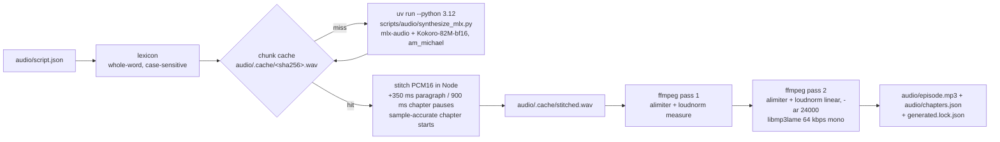

# Local audio setup (MLX + Kokoro-82M on Apple Silicon)

The podcast companion is synthesized **locally** with open weights; no cloud TTS, no API keys. CI never runs it — the MP3 and `chapters.json` are committed with `generated.lock.json`.

## TL;DR

```bash
bash scripts/setup-audio.sh                  # idempotent: checks/installs tools, runs a warm-up render in a temp dir
npm run audio -- --slug <slug>               # render one article (needs src/articles/<slug>/audio/script.json)
npm run audio                                # render every article with features.audio === true
```

## Pipeline



| Piece | File | Notes |
| :--- | :--- | :--- |
| Orchestrator | `scripts/render-audio.mjs` | `[--slug <slug>] [--force] [--articles-dir <dir>]`; plain Node, imports `sp.config.ts` + `schema.ts` via type stripping |
| Synthesizer | `scripts/audio/synthesize_mlx.py` | uv inline-script metadata pins every dependency; stdin JSON → one JSON line per chunk on stdout; logs on stderr |
| Config | `sp.config.ts` `audio` | `model: mlx-community/Kokoro-82M-bf16`, `voice: am_michael`, `langCode: 'a'`, `speed: 1.0`, `sampleRateHz: 24000`, `paragraphPauseMs: 350`, `chapterPauseMs: 900`, `targetLufs: -16`, `bitrateKbps: 64` |

### Pinned Python dependencies (from the script header)

`mlx-audio==0.6.7`, `mlx==0.32.4`, `soundfile==0.14.0`, `numpy==2.5.5`, `scipy==1.18.1`, `misaki[en]==0.9.4` (Kokoro's English G2P; not pulled by mlx-audio), `spacy==3.8.18`, `torch==2.15.0`, `transformers==5.24.0`, `huggingface-hub==2.4.0`, and spaCy `en_core_web_sm` 3.8.0 as a pinned wheel URL. Python `>=3.12,<3.13`. The Kokoro API used is `mlx_audio.tts.utils.load_model(repo_id)` + `model.generate(text, voice=, speed=, lang_code=)` (verified on 0.6.7, plan §8 4.2).

Changing any pin changes `toolVersion` (`mlx-audio@<pin>+synth.<sha256(synthesize_mlx.py)[0..16]>`), which invalidates every chunk cache key and every audio lock entry — expect a full re-render.

## Requirements

| Need | Why | Check |
| :--- | :--- | :--- |
| macOS on Apple Silicon (arm64, native shell — not Rosetta) | MLX runs on Apple GPUs only | `uname -m` → `arm64` |
| Node ≥ 22 (repo engines `>=22.23.4`) | Native TS type stripping for `sp.config.ts` / `schema.ts` | `node --version` |
| FFmpeg with `libmp3lame`, `alimiter`, `loudnorm`, `ebur128` | Loudness + MP3 encode | `brew install ffmpeg` |
| `uv` | Runs the PEP 723 inline script with pinned deps and Python 3.12 | `brew install uv` (any install on `PATH` works, e.g. via `mise`) |
| Disk | ~355 MB model in `~/.cache/huggingface/hub/models--mlx-community--Kokoro-82M-bf16`; ~1.2 GB uv environment (incl. torch) in `~/.cache/uv` | — |
| Network | First run only (model + wheels). Fully offline afterwards | — |

## `scripts/setup-audio.sh`

Idempotent; re-run any time.

1. Verifies macOS + arm64, Node ≥ 22, Homebrew (needed only to install missing tools).
2. Ensures `ffmpeg` and `uv` are on `PATH`, installing with `brew install` when missing (`--no-install` to only check). Verifies the FFmpeg encoder/filters above.
3. Reports whether the Kokoro model is already cached.
4. **Warm-up**: writes a 2-chapter `script.json` into a `mktemp -d` directory (never the repo), runs `scripts/render-audio.mjs --articles-dir <tmp>`, checks the MP3 duration and integrated loudness, then re-runs to prove the lock skip. The temp dir is deleted on exit (`--keep` keeps it; `--skip-warmup` skips this step).

Timings on the owner's machine: cold first run ~2 min (downloads, plan §8 4.2); warm run ~4 s total (~1.8 s per short chunk).

Reference warm output (2026-11-23):

```text
  ok    ffmpeg has libmp3lame, alimiter, loudnorm, ebur128
  ok    model cached: ~/.cache/huggingface/hub/models--mlx-community--Kokoro-82M-bf16
[render-audio] sp-audio-smoke: stitched 262800 samples (10.95s)
[render-audio] sp-audio-smoke: loudnorm pass 1 I=-28.27 TP=-13.98 LRA=5.30 thresh=-38.70 offset=0.01
  ok    episode.mp3: 10.950000s, integrated loudness -16.4 LUFS (target -16 +/- 1)
  ok    second run skipped via generated.lock.json (1 s)
```

## Rendering an article

1. Author `src/articles/<slug>/audio/script.json` (`AudioScriptSchema`; see [../workflows/article-media.md](../workflows/article-media.md)).
2. `npm run audio -- --slug <slug>`.
3. Set `features.audio: true` in `article.json` once the outputs exist.
4. Acceptance: re-run prints `up to date … skipping`; loudness check:

   ```bash
   ffmpeg -hide_banner -nostdin -i src/articles/<slug>/audio/episode.mp3 -af ebur128 -f null - 2>&1 | rg -A1 'Integrated loudness'
   ```

## Lock and skip semantics

| Situation | Behaviour |
| :--- | :--- |
| `inputHash` = sha256(`[raw script.json text, spConfig.audio, toolVersion]`) matches the lock **and** both outputs exist with their recorded `outputHash` | Whole article skipped: no synthesis, no FFmpeg |
| Script text, `spConfig.audio` or `toolVersion` changed | Re-render; only paragraphs whose chunk key changed are re-synthesized (chunk key = sha256 of `[model, voice, langCode, speed, toolVersion, spokenText]`) |
| Output edited or deleted by hand | Re-render (output hash mismatch) |
| `--force` | Re-render even when fresh |

`generatedAt` in the lock is kept when hashes are unchanged, so a no-op run leaves `git status` clean.

## Loudness: why `alimiter` precedes `loudnorm`

Kokoro speech has ~20 dB between true peak and integrated loudness. With `TP=-1.5`, `loudnorm` cannot apply linear gain and silently falls back to dynamic mode, landing ~1 dB under target (measured −17.1 LUFS on a 99 s clip). A gentle limiter ahead of both passes (`alimiter=limit=0.2:level=false:attack=5:release=50`) restores linear mode: −16.3 LUFS on the same clip. Pass 2 always passes `-ar 24000` because `loudnorm` resamples internally to 192 kHz (P22). Source: `scripts/render-audio.mjs` (two-pass block), plan §8 4.3.

## Determinism: never `--force` casually

- The MP3 encode is byte-deterministic for the same WAV (`-fflags +bitexact`, metadata stripped).
- **Kokoro synthesis is not deterministic.** Deleting `audio/.cache/` or running `--force` on a fresh clone produces a different MP3 and rewrites the committed binary. Use `--force` only when you intend to replace the published audio.
- `audio/.cache/` is git-ignored and local-only.

## Troubleshooting

| Symptom | Fix |
| :--- | :--- |
| `Apple Silicon (arm64) required` under an arm Mac | Terminal is running under Rosetta; open a native arm64 shell |
| `uv: command not found` inside `npm run audio` | `uv` must be on the `PATH` that `node` sees; with `mise`, activate it in the shell profile |
| First run looks stuck | It is downloading ~355 MB + building the uv env (~1.2 GB); progress goes to stderr. Allow ~2 min on a fast link |
| `ModuleNotFoundError` / spaCy model errors | Do not `pip install` anything; the uv inline-script pins own the env. `uv cache clean` then re-run to rebuild it |
| `torch.jit.script is deprecated` warning | Harmless (from a dependency) |
| Integrated loudness < −17 LUFS | Check the `alimiter` prefix is still in both passes; very short clips (< 10 s) measure noisily |
| `no audio/script.json` / `features.audio is true but audio/script.json is missing` | Author the script first, or set `features.audio: false` |
| Hugging Face rate limits / offline machine | Pre-populate `~/.cache/huggingface` from another machine, or set `HF_HOME` to a cache that has the model |
| Chapter times look ~46 ms early in some players | LAME priming delay (P21); acceptable, do not hand-correct |
