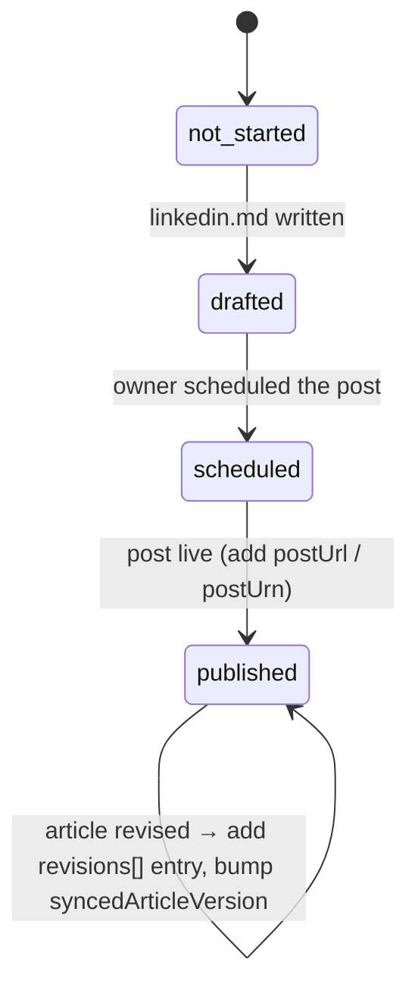

# Workflow: `article-social` — LinkedIn copy, tracking, LLM notes

Use when an article reaches `building`/`review` and needs its LinkedIn post, its tracking metadata, or its `llms-notes.md`. Read first: [../voice-and-quality.md](../voice-and-quality.md).

## `social/linkedin.md`

- ≤ 1,300 characters. Human-first hook in the first line (a concrete tension or number from the article, not a question bait).
- Same register and banned-filler rules as the article. Never name the audience's seniority ("for Principal Engineers…").
- One link: `https://sujeet.pro/<slug>/` (published URL only; never a draft or `/prototype/` URL).
- No hashtag spam (0–3 relevant tags at most). No emoji walls.
- Any number in the post must already be sourced in the article.
- Evolution articles: the hook is usually the gap between the interview answer and the right-sized design; the card is the Evolution Ladder image (`social/linkedin-card.png`, produced by [article-media.md](article-media.md)).

## `social/linkedin.json` lifecycle (`LinkedInMetadataSchema`)

| Field | Rule |
| :--- | :--- |
| `status` | `not-started` / `drafted` / `scheduled` / `published`. **Non-blocking**: social state never blocks a prose fix or the publish gate |
| `postUrl`, `postUrn` | Only after the owner posts. Never fabricate |
| `syncedArticleVersion` | `article.json` `version` the post copy matches |
| `cardPath` | Literal `social/linkedin-card.png` |
| `revisions[]` | `{ date, note }` per change after posting |

Posting is manual (the owner posts); no automation, no API calls.

## `llms-notes.md`

Short notes for LLM consumers, included in `/<slug>/llms-full.txt`:

- What the article decides and why, in 5–10 bullets.
- Assumptions (copy the `ASSUMPTION:` items verbatim) and the date pricing was checked (`pricingAsOf`).
- What the interactive lab shows that the text does not (levels, failure injection).
- Do not restate the whole article; do not include draft slugs or prototype URLs.
