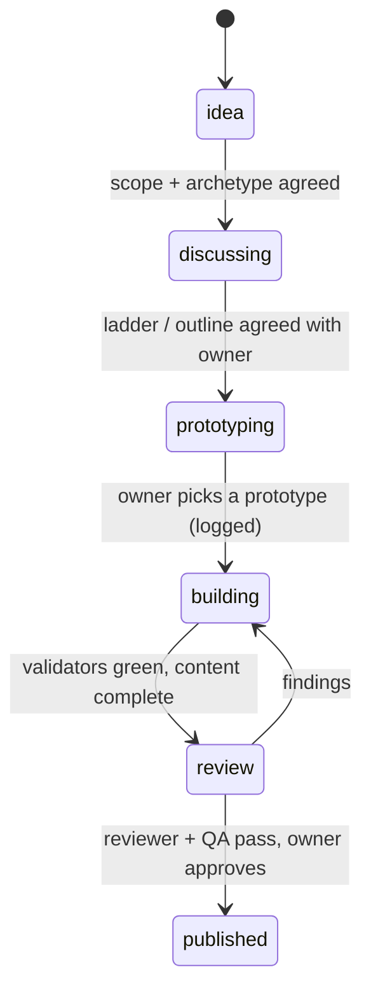

# Workflow: `article` — prototype-first lifecycle orchestrator

Use to start a new article or move an existing one to its next phase. Read first: [../archetypes-and-standards.md](../archetypes-and-standards.md), [../voice-and-quality.md](../voice-and-quality.md), [../architecture.md](../architecture.md).

**Definition of done for this workflow:** a fresh session can take a new slug from `idea` to `prototyping` using only this file and the files it links.

## State machine



`phase` lives in `article.json`. Anything except `published` is a draft (unlisted tier). Update `phase` and append to `logs/session-NNN.md` at every transition.

| Phase | Do | Exit criteria |
| :--- | :--- | :--- |
| `idea` | Create `src/articles/<slug>/` with `article.json` (`phase: "idea"`) and `pages/index.mdx` outline. Pick the archetype. Check `RESERVED_SLUGS` in `src/lib/articles/schema.ts` | Slug, archetype, title, one-line summary agreed with the owner |
| `discussing` | Socratic discussion with the owner. For evolution articles, **walk the evolution level by level** (below). Delegate fact-finding to the `article-researcher` agent | Ladder table (or outline for `standard`) agreed and recorded in `logs/`; open facts listed as `ASSUMPTION:` or research tasks |
| `prototyping` | Build `prototypes/v1.html` (or the next `vN`) via the [`article-prototype`](article-prototype.md) workflow | Owner picks a version/variant; pick + rationale logged in `logs/` |
| `building` | Implement data files, MDX pages, islands (delegate to `article-builder`); run media via [`article-media`](article-media.md); social via [`article-social`](article-social.md) | `npm run validate:junie`, `npx astro check`, `npm run build` green (plus `npm run validate` / `validate:dist` once they exist); every fact sourced or labelled |
| `review` | Run the `article-reviewer` agent, then the [`article-qa`](article-qa.md) workflow | No open blocker findings; QA checklist green |
| `published` | Set `phase: "published"`, `publishedAt`, `updatedAt`; satisfy the publish gate (plan §11) | Owner approves the live preview |

### `discussing` for evolution articles (Design X; Building Block / Business Story where useful)

For each level L0…Ln agree, in order:

1. **Trigger** — `kind` (`launch` | `scale` | `business` | `incident` | `feature-request` | `cost` | `org`) + a concrete scenario with a number or event.
2. **Minimum design** — only what this trigger needs.
3. **Deferred** — each item and the condition (`until`) that would bring it in.
4. **Exit criteria** — the observable signal that forces the next level.
5. **Build vs buy** — `configure` | `buy` | `build`, options, rationale.
6. **Cost band** — a tier id; numbers come later from official pricing or stay `ASSUMPTION:`.

Exit `discussing` when the ladder table is agreed, in this shape:

| Level | Mode | Trigger (scenario) | Design at this level | Deliberately deferred | Move up when |
| :--- | :--- | :--- | :--- | :--- | :--- |
| L0 | baseline | … | … | … | … |
| L1 | extend / replace | … | … | … | … |

## Templates

The Zod schemas in `src/lib/articles/schema.ts` are the authoritative templates; the flagship `src/articles/design-url-redirection-service/` is the worked example. Copy its files and edit; do not invent fields (all schemas are `strictObject`).

| File | Schema / reference | Notes |
| :--- | :--- | :--- |
| `article.json` | `ArticleManifestSchema` | Folder name = `slug`. `archetype`: `standard` / `design-x` / `business-story` / `building-block`. Drafts: no `publishedAt`. `features: { audio, pdf }` flip to `true` only after the pipeline has run |
| `pages/index.mdx` (+ more pages) | `pages[].entry` regex `^pages\/[a-z0-9-]+\.mdx$` | Statically import islands (P4). Evolution index: Summary → `<EvolutionLadder />` → `<EvolutionStage />` L0…Ln (ids `evolution-ladder`, `stage-l<n>`) |
| `prototypes/v1.html` | [article-prototype.md](article-prototype.md) | Standalone, `noindex` |
| `data/evolution.json` | `EvolutionSchema` (E1–E6) + `checkEvolutionRefs` (E7–E10) | One stage per agreed ladder row; `figures[].visual` = `stage-l<n>` |
| `data/topology.json` | `TopologySchema` | All nodes across all levels with fixed `x`/`y`; `awsLabel` for the Generic ↔ AWS toggle |
| `data/cost-models.json` | `CostModelSchema` | One tier per level (`l0`…`ln`); `pricingAsOf`, `sources[]` with official URLs; each component's `assumption` text |
| `audio/script.json` | `AudioScriptSchema` | Podcast order (not reading order); `{ text, spoken? }` paragraphs; `lexicon` for acronyms; chapters target `stage-l<n>` / `evolution-ladder` |
| `diagrams/architecture.diagram.json` | `TopologySchema` alias `SystemTopologySchema` | Optional for evolution articles |
| `social/linkedin.md`, `social/linkedin.json` | `LinkedInMetadataSchema` | [article-social.md](article-social.md) |
| `llms-notes.md` | free text | What an LLM should know that the page does not say; [article-social.md](article-social.md) |
| `logs/session-NNN.md` | free text | Decisions, owner feedback, prototype picks |
| `tests/article.e2e.ts` | Playwright | Ladder links, each stage toggle, level picker, cost values derived from `cost-models.json` (not hard-coded) |

Minimal `article.json` for a new draft:

```json
{
  "slug": "<slug>",
  "archetype": "design-x",
  "title": "<title>",
  "subtitle": "<one line>",
  "summary": "<one paragraph>",
  "phase": "idea",
  "tags": [],
  "concepts": [],
  "version": 1,
  "updatedAt": "<YYYY-MM-DD>",
  "features": { "audio": false, "pdf": false },
  "pages": [{ "title": "<title>", "entry": "pages/index.mdx", "summary": "<one line>" }]
}
```

One evolution stage (shape only; see `EvolutionStageSchema`):

```json
{
  "id": "l1-<short-name>", "level": 1, "title": "<title>", "mode": "extend",
  "trigger": { "kind": "business", "headline": "<event>", "scenario": "<concrete scenario>" },
  "requirements": [{ "label": "Rules", "value": "<number + unit>" }],
  "keyPoints": ["<bullet>", "<bullet>"],
  "decision": { "add": ["<node-id>"], "change": [], "remove": [], "defer": [{ "item": "<thing>", "until": "<condition>" }] },
  "buildVsBuy": { "verdict": "configure", "options": ["<option>"], "rationale": "<why>" },
  "costTierId": "l1",
  "figures": [{ "visual": "stage-l1", "alt": "<alt text>", "interactive": "diff" }],
  "exitCriteria": ["<observable signal>"]
}
```

## Series and graph

- Add the article to `src/series/series.json` only when it should appear in a series; then set `primarySeries`.
- Relations go in `article.json` `relations[]`. Linking a published article to a draft renders the unlinked Coming Soon card — that is intended.

## Guardrails

- Never edit `prototypes/v1.html` / `v2.html` of the flagship (frozen). New iterations are new files.
- Keep the site-wide WIP banner.
- Do not mark `published` without the owner's explicit approval.
